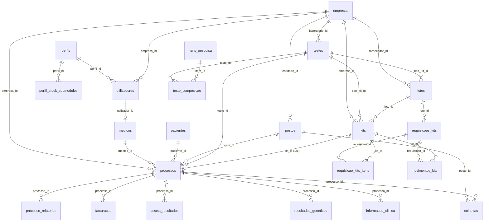

# Base de Dados — Genoma CRM

> Documento gerado a partir do schema **live** da base de dados `genoma` (MariaDB/MySQL).  
> Data de referência: 9 de junho de 2026.

---

## Informação geral

| Propriedade | Valor |
|---|---|
| **Motor** | MariaDB / MySQL (InnoDB) |
| **Base de dados** | `genoma` |
| **Charset** | `utf8mb4` |
| **Collation** | `utf8mb4_unicode_ci` |
| **Total de tabelas** | 29 |
| **Migrações** | `backend/src/migrations/` (000–015) |

---

## Resumo de registos

| Tabela | Registos |
|---|---:|
| anexos | 0 |
| assets_resultados | 0 |
| colheitas | 0 |
| empresas | 1 |
| facturacao | 0 |
| informacao_clinica | 0 |
| itens_pesquisa | 0 |
| kits | 4 |
| laboratorios | 0 |
| lembretes | 0 |
| logs_auditoria | 14 |
| lotes | 3 |
| medicos | 1 |
| movimentos_kits | 0 |
| pacientes | 1 |
| pedidos_exames | 0 |
| perfil_stock_submodulos | 15 |
| perfis | 3 |
| postos | 1 |
| processo_relatorios | 0 |
| processo_status | 9 |
| processos | 0 |
| requisicao_kits_itens | 0 |
| requisicoes_kits | 0 |
| resultados_detalhados | 0 |
| resultados_geneticos | 0 |
| teste_composicao | 0 |
| testes | 3 |
| utilizadores | 3 |

---

## Diagrama de relações (simplificado)

---

## Tabelas por domínio

### Autenticação e permissões

#### `perfis`
Perfis de acesso dos utilizadores.

| Coluna | Tipo | Null | Chave | Default |
|---|---|---|---|---|
| id | char(36) | NO | PRI | — |
| nome | varchar(50) | NO | UNI | — |
| ativo | tinyint(1) | YES | | 1 |

#### `utilizadores`
Contas de utilizador do sistema.

| Coluna | Tipo | Null | Chave | Default |
|---|---|---|---|---|
| id | char(36) | NO | PRI | — |
| perfil_id | char(36) | YES | MUL | — |
| empresa_id | char(36) | YES | MUL | — |
| nome | varchar(100) | NO | | — |
| email | varchar(100) | NO | UNI | — |
| telefone | varchar(20) | YES | | — |
| password_hash | text | NO | | — |
| ativo | tinyint(1) | YES | | 1 |
| created_at | timestamp | YES | | current_timestamp() |
| reset_token_hash | varchar(128) | YES | | — |
| reset_token_expires_at | datetime | YES | | — |

**FK:** `perfil_id` → `perfis.id` · `empresa_id` → `empresas.id`

#### `medicos`
Extensão do perfil de médico prescritor (1:1 com utilizador).

| Coluna | Tipo | Null | Chave | Default |
|---|---|---|---|---|
| utilizador_id | char(36) | NO | PRI | — |
| num_ordem | varchar(20) | NO | UNI | — |
| especialidade | varchar(100) | YES | | — |
| ativo | tinyint(1) | YES | | 1 |

**FK:** `utilizador_id` → `utilizadores.id` (CASCADE)

#### `perfil_stock_submodulos`
Permissões granulares por submódulo de stock.

| Coluna | Tipo | Null | Chave | Default |
|---|---|---|---|---|
| perfil_id | char(36) | NO | PRI | — |
| submodulo | varchar(30) | NO | PRI | — |
| permitido | tinyint(1) | NO | | 1 |
| updated_at | timestamp | YES | | current_timestamp() |

**FK:** `perfil_id` → `perfis.id` (CASCADE)

---

### Entidades e locais

#### `empresas`
Empresas, fornecedores e entidades associadas.

| Coluna | Tipo | Null | Chave | Default |
|---|---|---|---|---|
| id | char(36) | NO | PRI | — |
| nome | varchar(100) | NO | | — |
| morada | text | YES | | — |
| codigo_postal | varchar(20) | YES | | — |
| telefone | varchar(20) | YES | | — |
| email | varchar(100) | YES | UNI | — |
| created_at | timestamp | YES | | current_timestamp() |
| ativo | tinyint(1) | YES | | 1 |
| tipo_empresa | varchar(50) | YES | | — |
| nif | varchar(20) | YES | | — |
| pais | varchar(50) | YES | | — |
| contacto | varchar(100) | YES | | — |

#### `postos`
Postos de colheita / locais físicos.

| Coluna | Tipo | Null | Chave | Default |
|---|---|---|---|---|
| id | char(36) | NO | PRI | — |
| entidade_id | char(36) | YES | MUL | — |
| nome | varchar(100) | NO | | — |
| codigo_posto | varchar(20) | YES | UNI | — |
| localizacao | text | YES | | — |
| morada | text | YES | | — |
| codigo_postal | varchar(20) | YES | | — |
| cidade | varchar(120) | YES | | — |
| distrito | varchar(120) | YES | | — |
| pais | varchar(80) | YES | | — |
| contacto | varchar(100) | YES | | — |
| email | varchar(120) | YES | | — |
| ativo | tinyint(1) | NO | | 1 |
| created_at | timestamp | YES | | current_timestamp() |

**FK:** `entidade_id` → `empresas.id`

#### `laboratorios`
Laboratórios parceiros (entidade independente de `empresas`).

| Coluna | Tipo | Null | Chave | Default |
|---|---|---|---|---|
| id | char(36) | NO | PRI | — |
| nome | varchar(120) | NO | | — |
| codigo | varchar(40) | YES | UNI | — |
| morada | text | YES | | — |
| codigo_postal | varchar(20) | YES | | — |
| cidade | varchar(120) | YES | | — |
| distrito | varchar(120) | YES | | — |
| pais | varchar(80) | YES | | — |
| contacto | varchar(100) | YES | | — |
| email | varchar(120) | YES | | — |
| ativo | tinyint(1) | NO | | 1 |
| created_at | timestamp | YES | | current_timestamp() |

---

### Pacientes e contactos

#### `pacientes`
Contactos / pacientes.

| Coluna | Tipo | Null | Chave | Default |
|---|---|---|---|---|
| id | char(36) | NO | PRI | — |
| nome | varchar(100) | NO | | — |
| data_nascimento | date | NO | | — |
| genero | varchar(20) | YES | | — |
| nif | varchar(20) | YES | UNI | — |
| telemovel | varchar(20) | YES | | — |
| email | varchar(100) | YES | | — |
| morada | text | YES | | — |
| altura | decimal(5,2) | YES | | — |
| peso | decimal(5,2) | YES | | — |
| created_at | timestamp | YES | | current_timestamp() |
| ativo | tinyint(1) | YES | | 1 |
| codigo_postal | varchar(20) | YES | | — |
| pais | varchar(80) | YES | | — |
| distrito | varchar(80) | YES | | — |
| cidade | varchar(120) | YES | | — |

#### `anexos`
Documentos e e-mails associados a pacientes ou processos.

| Coluna | Tipo | Null | Chave | Default |
|---|---|---|---|---|
| id | char(36) | NO | PRI | — |
| paciente_id | char(36) | YES | MUL | — |
| processo_id | char(36) | YES | MUL | — |
| tipo | enum('Documento','Email','Outro') | YES | | Documento |
| titulo | varchar(200) | NO | | — |
| descricao | text | YES | | — |
| url | text | YES | | — |
| utilizador_id | char(36) | YES | | — |
| created_at | timestamp | YES | | current_timestamp() |

---

### Testes e catálogo

#### `testes`
Catálogo de testes genómicos (inclui metadados ADN fetal).

| Coluna | Tipo | Null | Chave | Default |
|---|---|---|---|---|
| id | char(36) | NO | PRI | — |
| nome | varchar(100) | NO | | — |
| preco | decimal(10,2) | YES | | 0.00 |
| descricao | text | YES | | — |
| ativo | tinyint(1) | YES | | 1 |
| codigo | varchar(20) | YES | | — |
| categoria | varchar(80) | YES | | — |
| laboratorio_id | char(36) | YES | MUL | — |
| tempo_estimado | int(11) | YES | | — |
| preco_compra | decimal(10,2) | YES | | 0.00 |
| preco_venda | decimal(10,2) | YES | | 0.00 |
| tempo_resposta_dias | int(11) | YES | | — |
| gestacao_minima_semanas | int(11) | YES | | — |
| tipo_teste | varchar(80) | YES | | — |
| empresa | varchar(80) | YES | | — |
| tipo_kit | varchar(80) | YES | | — |
| cromossomas | text | YES | | — |
| delecoes_duplicacoes | tinyint(1) | YES | | 0 |
| microdelecoes_microduplicacoes | tinyint(1) | YES | | 0 |
| gemeos | tinyint(1) | YES | | 0 |
| incluir_fracao_fetal | tinyint(1) | YES | | 1 |

**FK:** `laboratorio_id` → `empresas.id`

#### `itens_pesquisa`
Itens individuais analisados num teste.

| Coluna | Tipo | Null | Chave | Default |
|---|---|---|---|---|
| id | char(36) | NO | PRI | — |
| codigo | varchar(10) | NO | UNI | — |
| descricao | varchar(100) | NO | | — |
| ativo | tinyint(1) | YES | | 1 |

#### `teste_composicao`
Relação N:N entre testes e itens de pesquisa.

| Coluna | Tipo | Null | Chave | Default |
|---|---|---|---|---|
| teste_id | char(36) | NO | PRI | — |
| item_id | char(36) | NO | PRI | — |

**FK:** `teste_id` → `testes.id` · `item_id` → `itens_pesquisa.id`

---

### Stock — kits e lotes

#### `lotes`
Lotes de kits recebidos.

| Coluna | Tipo | Null | Chave | Default |
|---|---|---|---|---|
| id | char(36) | NO | PRI | — |
| codigo_lote | varchar(50) | NO | UNI | — |
| tipo_kit_id | char(36) | YES | MUL | — |
| data_rececao | timestamp | YES | | current_timestamp() |
| quantidade | int(11) | YES | | 0 |
| fornecedor_id | char(36) | YES | MUL | — |
| validade | date | YES | | — |
| estado | varchar(30) | YES | | Disponivel |

**FK:** `tipo_kit_id` → `testes.id` · `fornecedor_id` → `empresas.id`

#### `kits`
Kits individuais rastreáveis por código de barras.

| Coluna | Tipo | Null | Chave | Default |
|---|---|---|---|---|
| id | char(36) | NO | PRI | — |
| numero_kit | varchar(50) | YES | | — |
| tracking | varchar(100) | YES | | — |
| codigo_barras | varchar(50) | NO | UNI | — |
| tipo_kit_id | char(36) | YES | MUL | — |
| lote_id | char(36) | YES | MUL | — |
| empresa_id | char(36) | YES | MUL | — |
| posto_id | char(36) | YES | MUL | — |
| status | enum('Disponivel','Reservado','Em transito','Utilizado','Invalido','Perdido','Expirado') | YES | MUL | Disponivel |
| data_validade | date | YES | | — |
| localizacao | enum('Escritorio','Posto','Laboratorio') | YES | | Escritorio |

**FK:** `lote_id` → `lotes.id` · `empresa_id` → `empresas.id` · `posto_id` → `postos.id` · `tipo_kit_id` → `testes.id`

#### `requisicoes_kits`
Pedidos de transferência de kits entre locais.

| Coluna | Tipo | Null | Chave | Default |
|---|---|---|---|---|
| id | char(36) | NO | PRI | — |
| data | date | NO | | — |
| origem | enum('Escritorio','Posto','Laboratorio') | NO | | — |
| destino | enum('Escritorio','Posto','Laboratorio') | NO | | — |
| quantidade | int(11) | NO | | — |
| status | enum('Pendente','Em transito','Entregue','Cancelada') | YES | | Pendente |
| tracking_number | varchar(100) | YES | | — |
| transportadora | varchar(100) | YES | | — |
| lote_id | char(36) | YES | MUL | — |
| observacoes | text | YES | | — |
| created_at | timestamp | YES | | current_timestamp() |

**FK:** `lote_id` → `lotes.id`

#### `requisicao_kits_itens`
Kits incluídos numa requisição.

| Coluna | Tipo | Null | Chave | Default |
|---|---|---|---|---|
| id | char(36) | NO | PRI | — |
| requisicao_id | char(36) | NO | MUL | — |
| kit_id | char(36) | NO | MUL | — |
| created_at | timestamp | YES | | current_timestamp() |

**FK:** `requisicao_id` → `requisicoes_kits.id` · `kit_id` → `kits.id`

#### `movimentos_kits`
Histórico de movimentação de kits.

| Coluna | Tipo | Null | Chave | Default |
|---|---|---|---|---|
| id | char(36) | NO | PRI | — |
| data | date | NO | | — |
| kit_id | char(36) | NO | MUL | — |
| origem | enum('Escritorio','Posto','Laboratorio') | NO | | — |
| destino | enum('Escritorio','Posto','Laboratorio') | NO | | — |
| motivo | enum('Envio','Consumo','Reposicao','Transferencia','SMS Colheita') | NO | | — |
| observacoes | text | YES | | — |
| requisicao_id | char(36) | YES | MUL | — |
| created_at | timestamp | YES | | current_timestamp() |

**FK:** `kit_id` → `kits.id` · `requisicao_id` → `requisicoes_kits.id`

---

### Processos (domínio operacional principal)

> A tabela `pedidos_exames` é **legada**. O fluxo operacional atual vive em `processos`.

#### `processo_status`
Estados do workflow de processos.

| Coluna | Tipo | Null | Chave | Default |
|---|---|---|---|---|
| nome | varchar(40) | NO | PRI | — |
| ordem | int(11) | NO | | — |
| ativo | tinyint(1) | YES | | 1 |

**Valores seed:** Agendado (1) · Kit Reservado (2) · Colheita Realizada (3) · Enviado Laboratorio (4) · Em Analise (5) · Resultado Disponivel (6) · Validado (7) · Faturado (8) · Cancelado (9)

#### `processos`
Processo clínico/laboratorial — entidade central do CRM.

| Coluna | Tipo | Null | Chave | Default |
|---|---|---|---|---|
| id | char(36) | NO | PRI | — |
| numero_processo | varchar(20) | NO | UNI | — |
| paciente_id | char(36) | YES | MUL | — |
| medico_id | char(36) | YES | MUL | — |
| posto_id | char(36) | YES | MUL | — |
| kit_id | char(36) | YES | UNI | — |
| status_id | varchar(30) | YES | MUL | — |
| data_entrada | timestamp | YES | MUL | current_timestamp() |
| notas | text | YES | | — |
| teste_id | char(36) | YES | MUL | — |
| empresa_id | char(36) | YES | MUL | — |
| posto | varchar(120) | YES | | — |
| data_colheita | date | YES | | — |
| data_chegada_laboratorio | date | YES | | — |
| data_resultado | date | YES | | — |
| data_validacao | date | YES | | — |
| data_envio_relatorio | date | YES | | — |
| responsavel_fluxo | varchar(120) | YES | | — |
| relatorio_validado | tinyint(1) | YES | | 0 |
| relatorio_enviado_para | varchar(20) | YES | | Nenhum |
| resultado_tudo_ok | tinyint(1) | YES | | 1 |
| resultado_anomalias | text | YES | | — |
| fatura_emitida | tinyint(1) | YES | | 0 |
| fatura_numero | varchar(50) | YES | | — |
| fatura_data_emissao | date | YES | | — |
| valor_base | decimal(10,2) | YES | | 0.00 |
| desconto_percentual | decimal(5,2) | YES | | 0.00 |
| valor_final | decimal(10,2) | YES | | 0.00 |
| pagamento_data | date | YES | | — |
| recibo_numero | varchar(50) | YES | | — |
| observacoes | text | YES | | — |
| fracao_fetal | varchar(20) | YES | | — |
| pago | tinyint(1) | YES | | 0 |

**FK:** `paciente_id` → `pacientes.id` · `medico_id` → `medicos.utilizador_id` · `posto_id` → `postos.id` · `kit_id` → `kits.id` (UNIQUE — 1 kit = 1 processo) · `teste_id` → `testes.id` · `empresa_id` → `empresas.id`

**Índices:** `idx_processos_status`, `idx_processos_data_entrada`, `uk_processos_kit`

#### `colheitas`
Agendamentos e registo de colheitas. A API `/api/agendamentos` devolve também `paciente_id` (via `processos.paciente_id` ou contacto pré-processo) para navegação na UI operacional.

| Coluna | Tipo | Null | Chave | Default |
|---|---|---|---|---|
| id | char(36) | NO | PRI | — |
| processo_id | char(36) | YES | MUL | — |
| posto_id | char(36) | YES | MUL | — |
| data_prevista | date | YES | MUL | — |
| periodo | enum('Manhã','Tarde','Noite') | YES | | — |
| data_efetiva | datetime | YES | | — |
| created_at | timestamp | YES | | current_timestamp() |

**FK:** `processo_id` → `processos.id` · `posto_id` → `postos.id`

#### `informacao_clinica`
Dados clínicos da gravidez associados ao processo.

| Coluna | Tipo | Null | Chave | Default |
|---|---|---|---|---|
| id | char(36) | NO | PRI | — |
| processo_id | char(36) | YES | MUL | — |
| semanas_gravidez | int(11) | YES | | — |
| dias_gravidez | int(11) | YES | | — |
| tipo_gravidez | enum('singular','gemelar') | YES | | — |
| quer_saber_sexo | tinyint(1) | YES | | 0 |
| motivo_prescricao | text | YES | | — |
| data_registo | timestamp | YES | | current_timestamp() |

**FK:** `processo_id` → `processos.id`

#### `resultados_geneticos`
Resultados por cromossoma.

| Coluna | Tipo | Null | Chave | Default |
|---|---|---|---|---|
| id | char(36) | NO | PRI | — |
| processo_id | char(36) | YES | MUL | — |
| cromossoma | varchar(10) | YES | | — |
| resultado_valor | varchar(50) | YES | | — |
| probabilidade | varchar(50) | YES | | — |
| tipo_resultado | varchar(20) | YES | | — |

**FK:** `processo_id` → `processos.id`

#### `assets_resultados`
Ficheiros PDF/relatórios associados ao processo.

| Coluna | Tipo | Null | Chave | Default |
|---|---|---|---|---|
| id | char(36) | NO | PRI | — |
| processo_id | char(36) | YES | MUL | — |
| url_ficheiro | text | NO | | — |
| tipo_ficheiro | varchar(10) | YES | | PDF |
| data_upload | timestamp | YES | | current_timestamp() |

**FK:** `processo_id` → `processos.id`

#### `processo_relatorios`
Relatórios gerados e estado de envio.

| Coluna | Tipo | Null | Chave | Default |
|---|---|---|---|---|
| id | char(36) | NO | PRI | — |
| processo_id | char(36) | NO | MUL | — |
| template | varchar(120) | YES | | — |
| pdf_url | text | NO | | — |
| data_geracao | timestamp | YES | | current_timestamp() |
| estado_envio | enum('Pendente','Enviado','Falha') | YES | | Pendente |
| observacoes | text | YES | | — |

#### `facturacao`
Dados de faturação complementares ao processo.

| Coluna | Tipo | Null | Chave | Default |
|---|---|---|---|---|
| id | char(36) | NO | PRI | — |
| processo_id | char(36) | YES | MUL | — |
| preco_teste | decimal(10,2) | YES | | 0.00 |
| numero_fatura | varchar(50) | YES | | — |
| data_fatura | date | YES | | — |
| entidade_multibanco | varchar(20) | YES | | — |
| referencia_multibanco | varchar(20) | YES | | — |
| comissao | tinyint(1) | YES | | 0 |
| created_at | timestamp | YES | | current_timestamp() |
| updated_at | timestamp | YES | | current_timestamp() |

**FK:** `processo_id` → `processos.id` (CASCADE)

---

### Tarefas e lembretes

#### `lembretes`
Quadro de tarefas / agendamentos internos.

| Coluna | Tipo | Null | Chave | Default |
|---|---|---|---|---|
| id | char(36) | NO | PRI | — |
| titulo | varchar(255) | NO | | — |
| descricao | text | YES | | — |
| estado | enum('Pendente','Concluido') | NO | MUL | Pendente |
| prioridade | enum('Baixa','Normal','Alta') | NO | | Normal |
| data_limite | date | YES | MUL | — |
| paciente_id | char(36) | YES | MUL | — |
| processo_id | char(36) | YES | MUL | — |
| criado_por | char(36) | YES | | — |
| atribuido_a | char(36) | YES | | — |
| completed_at | timestamp | YES | | — |
| created_at | timestamp | YES | | current_timestamp() |

---

### Legado

#### `pedidos_exames` ⚠️ Legada
Modelo antigo de pedidos — substituído por `processos`.

| Coluna | Tipo | Null | Chave | Default |
|---|---|---|---|---|
| id | char(36) | NO | PRI | — |
| paciente_id | char(36) | NO | MUL | — |
| medico_id | char(36) | NO | MUL | — |
| teste_id | char(36) | NO | MUL | — |
| empresa_id | char(36) | NO | MUL | — |
| data_pedido | timestamp | YES | | current_timestamp() |
| status | enum('Aguardando Colheita','Em Laboratorio','Em Analise','Concluido','Cancelado') | YES | | Aguardando Colheita |
| notas_clinicas | text | YES | | — |
| ativo | tinyint(1) | YES | | 1 |

#### `resultados_detalhados` ⚠️ Legada
Resultados associados a `pedidos_exames`.

| Coluna | Tipo | Null | Chave | Default |
|---|---|---|---|---|
| id | char(36) | NO | PRI | — |
| pedido_id | char(36) | YES | MUL | — |
| item_id | char(36) | YES | MUL | — |
| resultado | varchar(100) | YES | | — |
| observacoes | text | YES | | — |
| data_resultado | timestamp | YES | | current_timestamp() |
| ativo | tinyint(1) | YES | | 1 |

---

### Auditoria

#### `logs_auditoria`
Registo de ações dos utilizadores.

| Coluna | Tipo | Null | Chave | Default |
|---|---|---|---|---|
| id | char(36) | NO | PRI | — |
| empresa_id | char(36) | YES | MUL | — |
| utilizador_id | char(36) | YES | MUL | — |
| acao | varchar(100) | YES | | — |
| tabela_afetada | varchar(100) | YES | | — |
| registro_id | char(36) | YES | | — |
| data | timestamp | YES | | current_timestamp() |

**FK:** `empresa_id` → `empresas.id` · `utilizador_id` → `utilizadores.id`

---

## Chaves estrangeiras (completas)

| Tabela origem | Coluna | Tabela destino | Coluna destino |
|---|---|---|---|
| assets_resultados | processo_id | processos | id |
| colheitas | processo_id | processos | id |
| colheitas | posto_id | postos | id |
| facturacao | processo_id | processos | id |
| informacao_clinica | processo_id | processos | id |
| kits | lote_id | lotes | id |
| kits | empresa_id | empresas | id |
| kits | posto_id | postos | id |
| kits | tipo_kit_id | testes | id |
| logs_auditoria | empresa_id | empresas | id |
| logs_auditoria | utilizador_id | utilizadores | id |
| lotes | fornecedor_id | empresas | id |
| lotes | tipo_kit_id | testes | id |
| medicos | utilizador_id | utilizadores | id |
| movimentos_kits | kit_id | kits | id |
| movimentos_kits | requisicao_id | requisicoes_kits | id |
| pedidos_exames | paciente_id | pacientes | id |
| pedidos_exames | medico_id | medicos | utilizador_id |
| pedidos_exames | teste_id | testes | id |
| pedidos_exames | empresa_id | empresas | id |
| perfil_stock_submodulos | perfil_id | perfis | id |
| postos | entidade_id | empresas | id |
| processos | paciente_id | pacientes | id |
| processos | medico_id | medicos | utilizador_id |
| processos | posto_id | postos | id |
| processos | kit_id | kits | id |
| processos | teste_id | testes | id |
| processos | empresa_id | empresas | id |
| requisicao_kits_itens | requisicao_id | requisicoes_kits | id |
| requisicao_kits_itens | kit_id | kits | id |
| requisicoes_kits | lote_id | lotes | id |
| resultados_detalhados | pedido_id | pedidos_exames | id |
| resultados_detalhados | item_id | itens_pesquisa | id |
| resultados_geneticos | processo_id | processos | id |
| teste_composicao | teste_id | testes | id |
| teste_composicao | item_id | itens_pesquisa | id |
| testes | laboratorio_id | empresas | id |
| utilizadores | perfil_id | perfis | id |
| utilizadores | empresa_id | empresas | id |

---

## Notas técnicas

1. **Soft delete:** A maioria das entidades usa o campo `ativo` (BOOLEAN) em vez de eliminação física.
2. **UUIDs:** Identificadores primários são `CHAR(36)` (UUID v4).
3. **Integridade kit ↔ processo:** `processos.kit_id` tem índice UNIQUE — cada kit só pode estar associado a um processo.
4. **Tabelas sem FK declarada (apenas índice):** `anexos`, `lembretes`, `processo_relatorios` — referências lógicas a pacientes/processos/utilizadores sem constraint na BD.
5. **FK pendente:** `processos.status_id` → `processo_status.nome` está definida nas migrações mas **não está aplicada** na BD live.
6. **Migrações neutralizadas:** `003` (workflow em pedidos_exames) e `008` (duplicação de tabelas de stock) são no-op.

---

## Histórico de migrações

| # | Ficheiro | Descrição |
|---|---|---|
| 000 | `000_create_base_tables.js` | Tabelas base |
| 001 | `001_create_logs.js` | Logs de auditoria |
| 002 | `002_add_soft_delete.js` | Campo `ativo` + altura/peso |
| 003 | `003_add_pedidos_workflow_billing.js` | ⚠️ No-op (supersedido) |
| 004 | `004_create_perfil_stock_submodulos.js` | Permissões de stock |
| 005 | `005_add_password_reset_fields.js` | Reset de password |
| 006 | `006_update_lotes_kits_tipos_kit.js` | Stock: lotes, kits, enums |
| 007 | `007_create_requisicoes_movimentos.js` | Requisições e movimentos |
| 008 | `008_create_requisicoes_movimentos_tables.js` | ⚠️ No-op (supersedido) |
| 009 | `009_align_processos_core.js` | Processos como entidade central |
| 010 | `010_processo_kit_integrity_indexes.js` | Índices e 1:1 kit/process |
| 011 | `011_contactos_morada_anexos.js` | Morada pacientes + anexos |
| 012 | `012_testes_metadata.js` | Metadados ADN fetal |
| 013 | `013_processos_fracao_fetal_pago.js` | Fração fetal + pago |
| 014 | `014_lembretes.js` | Tarefas/lembretes |
| 015 | `015_locais_postos_laboratorios.js` | Postos estendidos + laboratórios |
