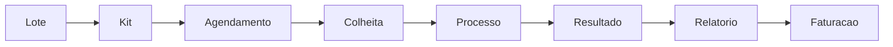

# Genoma CRM — Ponto de Situação e Perguntas ao Cliente

**Data:** 11 de junho de 2026
**Para:** Equipa Genoma
**Assunto:** O que já está feito no novo sistema e o que precisamos de confirmar convosco

> Este documento foi escrito de forma simples, sem linguagem técnica. O objetivo é
> que qualquer pessoa da Genoma perceba **o que foi construído até agora** e
> **que decisões precisamos que validem** para avançarmos com confiança.

---

## Parte 1 — Em que ponto está o projeto

Estamos a transformar o sistema da Genoma num **sistema operacional completo** para
gestão de testes genéticos — não apenas uma lista de contactos, mas uma ferramenta que
acompanha cada amostra desde que o material chega até à fatura final.

O fluxo real da Genoma que o sistema passa a refletir é este:

Em linguagem simples: compram material em **lotes**, cada lote dá origem a vários **kits**
com código de barras, um kit é reservado quando se **agenda** uma colheita, a colheita
inicia um **processo** (o "dossier" do exame), que avança até ao **resultado**, ao
**relatório** e à **faturação**.

Abaixo, ponto a ponto, o que já foi realizado.

### 1. Módulo de Processos (o coração do sistema)
- Deixou de ser uma simples tabela e passou a ser um **painel de trabalho**.
- Mostra logo à entrada **o que precisa de atenção**: processos atrasados, resultados à
  espera de validação, processos prontos a faturar, colheitas do dia.
- Tem uma **vista de "quadro" (pipeline)** onde se vê em que fase está cada exame, como
  num quadro de post-its por coluna (Agendado, Em análise, Resultado, Validado, etc.).
- O sistema **só permite avançar para fases válidas** — deixou de ser possível "saltar"
  etapas por engano. Isto reduz erros humanos.
- Cada processo abre num **painel lateral** com separadores: Resumo, Fluxo de trabalho,
  Resultado, Relatório, Faturação, Rastreabilidade e Histórico.
- **Correção recente:** a **data de entrada** do processo passa a aparecer no dia correto
  (ex.: dia 12 e não dia 11), alinhada com a data guardada nos contactos. O problema era
  técnico (fuso horário) e já está corrigido no backend e no ecrã de edição.

### 2. Módulo de Contactos e conversão em processo
- O fluxo de **criar contacto → associar kit → gerar processo** está operacional.
- A data de entrada do processo é definida no **dia da conversão** (calendário local),
  em linha com a data efetiva da colheita quando aplicável.
- Após editar o perfil do utilizador, o **nome atualizado** reflete-se na barra lateral
  e na lista de utilizadores sem precisar de atualizar a página.

### 3. Módulo de Stocks (inventário de kits e lotes)
- Mostra de forma clara **quanto material existe e onde está cada kit**.
- Indicadores no topo: kits disponíveis, kits reservados/em trânsito, lotes a expirar,
  kits já fora de validade, requisições pendentes e uma estimativa de **quantos dias de
  stock restam**.
- **Alertas automáticos**: stock baixo, lotes perto da validade, requisições paradas.
- Permite criar/editar kits e lotes, registar movimentos entre locais e fazer requisições
  (envio de kits de um sítio para outro), com o stock a atualizar-se sozinho.
- Tem um **registo de auditoria** (quem fez o quê e quando) guardado na base de dados.

### 4. Novo Módulo de Agendamentos (a porta de entrada)
- Foi criado de raiz um **calendário de colheitas**, com cores conforme a carga de cada dia.
- Ao agendar, o sistema **reserva automaticamente um kit** — garante que não se marca uma
  colheita sem material disponível.
- A partir do agendamento, **o processo é criado automaticamente**, poupando trabalho manual.

### 5. Módulo de Listagens (centro de relatórios e consultas)
- Deixou de ser duas tabelas para passar a ser um **centro de consulta e extração de dados**.
- Tem **9 listagens** prontas: Processos, Resultados, Faturação, Colheitas, Kits, Lotes,
  Pacientes, Médicos e Auditoria.
- **Menu lateral alinhado:** todas estas listagens aparecem agora na barra lateral em
  **Listagens**, com ligação direta a cada separador (antes só apareciam duas entradas).
- **Pesquisa global instantânea** (atalho Ctrl/Cmd+K): escreve-se um nome, número, código
  de kit ou lote e o sistema encontra em todas as áreas ao mesmo tempo.
- **Filtros avançados** por datas, estado, médico, posto, empresa, tipo de teste, etc.
- **Exportação real** de qualquer listagem para **Excel, CSV e PDF**, respeitando os filtros
  aplicados.

### 6. Administração (configuração do sistema)
- Área de **Administração** com separadores: Utilizadores, Perfis e Permissões, Empresas,
  Testes, Tipos de Kit, Postos, Laboratórios, Médicos e **Motivos de anulação** (novo).
- **Motivos de anulação:** tabela para gerir razões de cancelamento (ex.: Desistência,
  Erro atribuição processo, Perda do bebé, Repetição de colheita), com criar, editar e
  eliminar. Já inclui motivos base pré-carregados.
- **Testes:** formulário organizado em separadores **Dados** e **Maternity** (campos
  clínicos/genéticos).
- **Utilizadores:** criação sem password obrigatória; o utilizador define a password via
  **Recuperar Password** no login. O perfil **Administrador** é único e não pode ser criado
  nem eliminado pela interface.
- **Placeholders** nos formulários de criação (empresas, postos, laboratórios, utilizadores,
  tipos de kit, etc.) para orientar o preenchimento.
- Formulários com validação e mensagens de erro claras em português.

### 7. Perfil do utilizador
- No menu do utilizador (canto inferior da barra lateral), é possível **editar perfil**:
  nome de apresentação, email e **foto de perfil**.
- A foto guardada aparece na barra lateral e no menu da conta.

### 8. Rastreabilidade ponta a ponta
- É possível seguir a "cadeia de vida" de uma amostra nos **dois sentidos**:
  de um **Lote** ver todos os kits e processos que gerou; de um **Resultado** recuar até
  ao lote de origem.
- Isto é essencial para **conformidade e para um eventual recall** (recolha de material de
  um lote com problema).

### 9. Automação de notificações
- O sistema já está preparado para **enviar avisos automáticos por e-mail/SMS** em
  acontecimentos-chave (ex.: colheita agendada, relatório enviado, stock baixo).
- Estes envios estão ligados internamente; falta apenas **ligar os canais reais** de envio
  (ver perguntas abaixo).

### Estado técnico (em uma frase)
Todas estas áreas estão **construídas e a compilar sem erros**. As migrações de base de
dados necessárias (incluindo foto de perfil, motivos de anulação e password opcional em
novos utilizadores) estão definidas. O que se segue depende sobretudo de **decisões de
negócio vossas**, de validação em ambiente real e de alguns acessos/configurações.

### O que ainda não está ligado ao fluxo operacional
- Os **motivos de anulação** estão na Administração, mas ainda **não aparecem como opção**
  ao cancelar um processo — falta ligar essa lista ao ecrã de processos.
- As **notificações** por e-mail/SMS dependem de credenciais e regras vossas.
- **Importação** de dados históricos e **modelo de relatório/fatura** personalizado Genoma
  aguardam material e regras do cliente.

---

## Parte 2 — Perguntas para a Genoma

Precisamos das vossas respostas para afinar o sistema à vossa realidade. Agrupámos por tema.
Não é preciso responder a tudo de uma vez — podemos ir por prioridades.

### A. Fluxo de trabalho e estados
1. A sequência de fases do processo (Agendado → Kit Reservado → Colheita → Enviado ao
   Laboratório → Em Análise → Resultado → Validado → Faturado) corresponde **exatamente**
   ao vosso processo real? Falta ou sobra alguma fase?
2. Quem tem autoridade para **validar um resultado**? Deve ser sempre uma pessoa específica
   (ex.: responsável clínico)?
3. A partir de quantos dias parado é que um processo deve ser considerado **"atrasado"**?
   (de momento usamos 7 dias)
4. A lista de **motivos de anulação** que carregámos (Desistência, Erro atribuição processo,
   Perda do bebé, Repetição de colheita) está completa? Há mais motivos obrigatórios?
   Algum motivo **não deve poder ser eliminado** pela interface?

### B. Agendamentos e postos de colheita
5. Têm uma lista oficial de **postos de colheita**? Hoje, na falta dela, usamos as empresas
   marcadas como posto. Querem uma gestão dedicada de postos?
6. Uma colheita deve **reservar sempre um kit** no momento do agendamento, ou há casos em
   que se agenda sem garantir kit?

### C. Resultados, relatórios e faturação
7. O relatório é gerado em **PDF para impressão** (modelo atual). Querem um **modelo
   gráfico específico da Genoma** (logótipo, cabeçalho, rodapé, texto legal)? Podem
   enviar-nos um exemplo do relatório atual?
8. As **faturas** devem ter uma numeração automática (ex.: FAT-2026-0001)? Existe alguma
   regra legal/contabilística a respeitar (séries, IVA, etc.)?
9. A faturação precisa de se ligar a algum **software de contabilidade/faturação certificado**
   que já usem? Qual?

### D. Notificações automáticas (e-mail / SMS)
10. Querem ativar os **e-mails e SMS automáticos**? Se sim:
    - Qual o servidor de e-mail a usar (ex.: conta Google, Outlook, servidor próprio)?
    - Têm um serviço de envio de SMS contratado? Qual?
11. Em que acontecimentos querem mesmo enviar avisos, e **para quem** (paciente, médico,
    posto, equipa interna)?

### E. Stocks e material
12. A partir de que **quantidade de kits** o sistema deve alertar "stock baixo"?
    (usamos 5 por defeito)
13. Com quantos dias de antecedência querem ser avisados de um **lote a expirar**?
    (usamos 45 dias)
14. Quando um kit é dado como "Inválido/Perdido/Expirado", há algum procedimento interno
    que o sistema deva registar ou exigir?

### F. Pessoas, permissões e exportações
15. Que **perfis de utilizador** existem na Genoma (ex.: rececionista, técnico de
    laboratório, gestão, financeiro) e o que cada um pode ver/fazer?
16. **Quem pode exportar dados** (Excel/PDF/CSV)? Há informação sensível que deva ficar
    limitada a certos perfis?
17. Para efeitos de **proteção de dados (RGPD)**, há campos de pacientes que não devem
    aparecer em listagens ou exportações?

### G. Dados e arranque
18. Têm dados atuais (pacientes, médicos, histórico de processos, lotes/kits) que queiram
    **importar** para o novo sistema? Em que formato estão (Excel, outro sistema)?
19. Querem que façamos uma **sessão de demonstração** para validarem o fluxo antes de
    avançarmos para a próxima fase?

---

## Próximos passos sugeridos
1. Marcar uma reunião curta para responder às perguntas das secções A a D (as mais urgentes).
2. **Validar em ambiente real** o fluxo contacto → processo (datas, kit, nome do paciente)
   e confirmar que a data de entrada nos processos está correta após reinício do backend.
3. Confirmar a lista final de **motivos de anulação** e priorizar a ligação ao ecrã de
   cancelamento de processos.
4. Recebermos um exemplo do **relatório** e das **regras de faturação** atuais.
5. Confirmarem os **acessos** de e-mail/SMS, caso queiram ativar as notificações.
6. Combinarmos uma **demonstração** do sistema tal como está (incluindo Administração,
   listagens na sidebar, perfil com foto e edição de processos).
