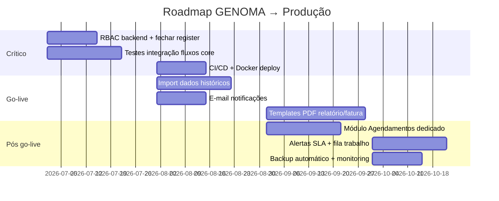

# GENOMA CRM — Roadmap para Produção

**Data:** 27 de junho de 2026  
**Objectivo:** Análise do estado actual do projecto e plano de melhorias para go-live em produção.

---

## Resumo executivo

O GENOMA já é um **CRM operacional completo** — não é apenas uma lista de contactos. Tem máquina de estados de processos, ciclo de vida de kits, listagens com exportação, auditoria e isolamento por médico.

Para **produção real**, o que falta divide-se em três camadas:

1. **Funcionalidade de negócio** — notificações, import histórico, templates PDF
2. **Robustez técnica** — testes, RBAC na API, CI/CD, validação
3. **Operação do dia-a-dia** — backups, logging, monitorização, filas de trabalho

> **Conclusão:** A força está no domínio de negócio bem modelado. A fraqueza principal é a “camada industrial” (testes, segurança API, deploy, notificações, documentos oficiais).

---

## O que já está bem encaminhado

| Área | Estado |
|------|--------|
| Fluxo clínico | Contacto → colheita/kit → processo → laboratório → resultado → faturação |
| Inventário | Lotes, kits, requisições, descarte, alertas de stock |
| Relatórios | Painel de Bordo, 10 listagens, export Excel/CSV/PDF |
| Regras de negócio | Transições de estado, motivos de anulação, rastreabilidade de kits |
| Auditoria | `logs_auditoria` usado em dezenas de serviços |
| Notificações in-app | Centro de alertas com categorias, preferências por utilizador e mensagens contextualizadas |
| Design system | Tokens slate/teal, toggles consistentes (matriz de permissões, parâmetros Maternity) |
| Arquitectura | Express 5 + React/Vite + MariaDB, 59 migrations, state machine |

### Stack técnica

| Camada | Tecnologias |
|--------|-------------|
| Frontend | React 18, Vite 6, React Router 7, Tailwind 4, MUI 7, Radix UI |
| Backend | Node ≥18, Express 5, mysql2, JWT, bcrypt, Helmet, rate-limit |
| Base de dados | MariaDB 11 (Docker compose disponível) |
| Documentação | `README.md`, `BASE_DE_DADOS.md`, `backend/ARCHITECTURE.md`, `PONTO_DE_SITUACAO_E_PERGUNTAS_CLIENTE.md` |

### Módulos implementados

| Módulo | Rotas / API | Ficheiros principais |
|--------|-------------|----------------------|
| Dashboard | `/` | `DashboardPage.tsx`, `MedicoDashboard.tsx` |
| Contactos | `/contactos` | `ContactFormPage.tsx`, `ContactDetail.tsx` |
| Processos | `/processos` | `ProcessesPage.tsx`, Kanban, `ProcessDrawer.tsx` |
| Inventário | `/stocks` | `StocksPage.tsx`, Lotes, Kits, Requisições, Descartes |
| Listagens | `/listagens` | `ListingsPage.tsx`, Painel de Bordo, exportações |
| Administração | `/definicoes` | Utilizadores, perfis, empresas, testes, postos, labs |
| Auth | `/login` | JWT, forgot/reset password |
| Agendamentos | `/api/agendamentos` | Calendário (embutido no fluxo de contactos) |

---

## Prioridade 1 — Crítico (antes de produção)

### 1.1 Segurança: RBAC no backend

**Problema:** As permissões por módulo (`frontend/src/lib/permissions.ts`, matriz em Definições) vivem sobretudo no browser. Na API, a maioria das rotas exige apenas **login** — `requireAdmin` aparece sobretudo em perfis; stocks tem sub-módulos; processos/contactos/admin **não têm RBAC equivalente no backend**.

**Risco:** Qualquer utilizador autenticado com token pode chamar APIs de admin via Postman ou script.

**Acção:**

- [ ] Criar middleware `requireModuleAccess('processos', 'read'|'create'|'update'|'delete')`
- [ ] Aplicar em todas as rotas sensíveis: `utilizadores`, `empresas`, `testes`, `medicos`, `postos`, `processos`, `pacientes`
- [ ] Alinhar com a matriz de permissões já existente na UI (`definicoes/PermissionsMatrix.tsx`)
- [ ] Testes de integração: utilizador sem permissão recebe 403

**Ficheiros relevantes:**

- `backend/src/middleware/authorization.middleware.js`
- `backend/src/routes/*.js`
- `frontend/src/lib/permissions.ts`

---

### 1.2 Testes automatizados

**Problema:** O backend declara Jest em `package.json` mas **não há ficheiros de teste** nem Jest nas `devDependencies`. Zero cobertura unitária, integração ou E2E.

**Risco:** Regressões como dados de colheita apagados ao guardar processo passam despercebidas.

**Acção — mínimo viável:**

- [ ] Instalar Jest + Supertest no backend
- [ ] Testes de integração: `processos.service.js` (transições válidas/inválidas)
- [ ] Testes: `kit-lifecycle.service.js`, descarte, requisições
- [ ] Testes: conversão contacto → processo (snapshot de colheita preservado)
- [ ] 1–2 testes E2E (Playwright): login → criar contacto → associar kit → ver processo
- [ ] Adicionar `npm test` ao CI

**Casos de teste prioritários** (ver também `relatorio_final/05_TEST_CASES_E_RASTREABILIDADE.md`):

| ID | Fluxo |
|----|-------|
| TC-01 | Criar contacto com colheita → associar kit → processo com dados intactos |
| TC-02 | Avançar processo só para estados válidos |
| TC-03 | Cancelar processo exige motivo de anulação |
| TC-04 | Descarte de kit actualiza stock e estado do processo |
| TC-05 | Médico só vê os seus processos/contactos |

---

### 1.3 CI/CD básico

**Problema:** Não existe pipeline (`.github/workflows/` vazio).

**Acção:**

```yaml
# Pipeline mínimo sugerido
lint → typecheck (frontend) → testes backend → build frontend → migrate (staging)
```

- [ ] GitHub Actions: `ci.yml` em push/PR
- [ ] Job backend: `npm ci && npm test && npm run migrate` (DB de teste)
- [ ] Job frontend: `npm ci && npm run build`
- [ ] (Opcional) Deploy automático para staging

---

### 1.4 Registo aberto

**Problema:** `POST /api/auth/register` está exposto sem gate de administrador.

**Acção:**

- [ ] Desactivar registo em produção (`NODE_ENV=production`) **ou**
- [ ] Restringir a utilizadores com perfil Admin
- [ ] Documentar fluxo: admin cria utilizadores em Definições

**Ficheiro:** `backend/src/routes/auth.routes.js`

---

### 1.5 Validação de input na API

**Problema:** Existe `backend/src/middleware/validators.js` (~300 linhas) mas **não está ligado às rotas**. Validação ad hoc nos services.

**Acção:**

- [ ] Ligar `validationMiddleware` às rotas de pacientes, processos, stocks, auth
- [ ] Respostas 400 consistentes com mensagens claras
- [ ] Reduzir erros SQL obscuros (FK, duplicados)

---

## Prioridade 2 — Funcionalidade para go-live

### 2.1 Notificações — canal externo (e-mail / SMS)

**Estado actual (Jun/2026):**

| Camada | Implementado | Pendente |
|--------|--------------|----------|
| **In-app** | `GET /api/notificacoes`, filtros por categoria (processos, contactos, faturação contacto/processo, inventário, lembretes), sino na topbar, página dedicada, preferências em Definições (`localStorage`) | Push browser (opcional) |
| **Mensagens** | Referência ao utilizador com título (Dr./Dra.), concordância «do contacto», alertas operacionais de faturação | — |
| **E-mail/SMS** | Infraestrutura preparada; eventos registados | nodemailer / SendGrid / SMS webhook |

**Casos de uso (canal externo):**

| Canal | Evento |
|-------|--------|
| E-mail | Resultado disponível, fatura emitida, alerta stock baixo |
| E-mail | Lembrete de colheita (dia anterior) |
| SMS (opcional) | Confirmação de colheita ao utente |

**Acção:**

- [ ] Instalar nodemailer (ou integrar SendGrid / AWS SES)
- [ ] Templates HTML configuráveis (resultado, fatura, lembrete)
- [ ] Variáveis de ambiente: `SMTP_HOST`, `SMTP_USER`, `SMTP_PASS`, `SMTP_FROM`
- [ ] (Opcional) Webhook SMS (`SMS_WEBHOOK_URL`)
- [x] UI em Definições para activar/desactivar notificações por tipo (in-app)
- [x] Filtros por categoria na página de notificações e no sino

**Ficheiros (in-app):** `notificacoes.service.js`, `notificacoes.repository.js`, `NotificationsPage.tsx`, `Topbar.tsx`, `AccountSettingsModal.tsx`, `frontend/src/lib/notificacoes.ts`

---

### 2.2 Módulo Agendamentos dedicado

**Estado actual:** Calendário e reserva de kit existem (`AgendaCalendar.tsx`, `/api/agendamentos`) mas **não há rota `/agendamentos`** — está embutido no fluxo de contactos.

**Acção:**

- [ ] Rota `/agendamentos` com vista semanal/mensal
- [ ] Filtro por posto e médico
- [ ] Carga por dia (cores verde/amarelo/vermelho já no backend)
- [ ] Acção rápida: reagendar, cancelar, ver contacto associado

**Ficheiros:** `frontend/src/app/components/agendamentos/`, `backend/src/services/colheitas.service.js`

---

### 2.3 Importação de dados históricos

**Estado actual:** Pendente (mencionado no ponto de situação com cliente).

**Acção:**

- [ ] Script CLI ou endpoint admin: import CSV/Excel
- [ ] Entidades: contactos, processos fechados, kits em stock, lotes
- [ ] Mapeamento de estados antigos → estados GENOMA
- [ ] Modo dry-run + relatório de erros pós-import
- [ ] Documentação para equipa Genoma

---

### 2.4 Templates PDF (relatório e fatura)

**Estado actual:** Campos de faturação e resultados existem; **documentos PDF oficiais** com layout Genoma parecem por customizar.

**Acção:**

- [ ] Template PDF relatório genético (logo, cabeçalho, resultados, assinatura)
- [ ] Template PDF factura (NIF, linhas, IVA se aplicável)
- [ ] Geração a partir do processo (botão “Emitir relatório” / “Emitir fatura”)
- [ ] Armazenamento em `anexos` ou storage externo

---

### 2.5 Painel de Bordo e alertas SLA

**Estado actual:** Painel de Bordo e KPIs existem; datas de colheita/envio lab foram corrigidas recentemente.

**Melhorias:**

- [ ] Alertas proactivos: processos há X dias em “Em Análise”
- [ ] Colheitas agendadas hoje/amanhã por posto
- [ ] Kits expirados ainda “Disponíveis”
- [ ] Processos validados há Y dias sem faturar
- [ ] Fila de trabalho: “O que fazer agora” por perfil (médico vs admin)

---

### 2.6 Rastreabilidade completa (UI)

**Estado actual:** `/api/trace` e movimentos de kits existem.

**Acção:**

- [ ] Ecrã único por processo: lote → kit → posto colheita → envio lab → lab final → resultado
- [ ] Validar completude para auditorias (ISO, acreditação lab)
- [ ] Integrar no drawer de processos (separador Rastreabilidade)

---

## Prioridade 3 — Robustez e operação

| Área | Estado actual | Acção recomendada |
|------|---------------|-------------------|
| **Migrações** | 59 ficheiros; sem `schema_migrations` | Tabela de versão; falhar deploy se migração falhar |
| **Backups** | Export manual (`npm run export:database`) | Backup automático diário MariaDB + retenção 30 dias |
| **Logging** | `console.log` apenas | Winston/Pino com níveis + rotação de ficheiros |
| **Monitorização** | Só `GET /health` | Sentry (erros FE/BE) + uptime check (UptimeRobot, etc.) |
| **Docker** | Só MariaDB (`backend/docker-compose.yml`) | Dockerfile backend + nginx frontend + compose completo |
| **Swagger** | ~9 endpoints de ~28 módulos | Completar spec **ou** remover UI enganosa |
| **TypeScript FE** | `.tsx` sem `tsconfig` / typecheck | `tsc --noEmit` no CI |
| **JWT** | `JWT_EXPIRE=7d` no `.env` mas código usa `8h` | Alinhar config; refresh token ou re-login claro |
| **Secrets** | Credenciais exemplo em `.env.example`, README | Rotação; nunca commitar `.env` |
| **Rate limit** | Desactivado em `NODE_ENV=development` | Garantir `NODE_ENV=production` em prod |
| **Legacy API** | `/api/pedidos`, `/api/resultados` deprecated | Remover após confirmar que ninguém usa |

### Migrações — melhoria do runner

**Problema:** `backend/migrate.js` executa todas as migrações ordenadas; falhas individuais são logged mas o processo continua e termina com exit 0.

**Acção:**

- [ ] Tabela `schema_migrations (filename, executed_at)`
- [ ] Executar só migrações novas
- [ ] Exit code ≠ 0 em falha (para CI)

### Backups — procedimento sugerido

```bash
# Manual (já existe)
cd backend && npm run export:database

# Produção (cron diário)
mysqldump -u $USER -p$PASS genoma > /backups/genoma_$(date +%Y%m%d).sql
# Retenção: apagar ficheiros > 30 dias
```

---

## Prioridade 4 — UX (quick wins)

| Melhoria | Descrição |
|----------|-----------|
| **Fila de trabalho por perfil** | Médico: “meus processos pendentes”; Admin: stock baixo + atrasos |
| **Pesquisa global (Ctrl+K)** | Garantir Nº processo, kit, NIF, nome em todas as áreas |
| **Confirmações** | Descarte, cancelamento, avanços críticos de estado |
| **Mobile/tablet nos postos** | Vista “colheitas do dia” simplificada; kanban degradado em ecrã pequeno |
| **Banner dados incompletos** | Processo sem posto/data colheita, ou “Em Análise” sem envio lab — alerta no kanban |
| **i18n** | Infra PT/EN; categorias de notificação traduzidas | Completar restantes traduções ou desactivar EN até estar pronto |
| **Design system** | Tokens slate/teal; toggles tipo matriz em permissões e Maternity | Estender a formulários legacy ainda em `gray-*` |
| **Loading states** | Uniformizar skeletons/spinners em formulários e listagens |
| **Mensagens de erro** | Toasts consistentes (sonner) em todas as acções |

### Protecção de dados imutáveis (lição aprendida)

Bug corrigido em jun/2026: dados de colheita apagados ao guardar processo.

**Regras a manter:**

- Campos de colheita (posto, datas) são **snapshot** na criação do processo
- Frontend não envia estes campos em updates
- Backend rejeita limpar valores existentes
- API enriquece processos com tabela `colheitas` quando campos em `processos` estão vazios

---

## Roadmap sugerido (calendário)



---

## Top 5 acções antes de produção

Se só puderem fazer cinco coisas, nesta ordem:

1. **RBAC no backend** — espelhar permissões da UI na API
2. **Testes dos fluxos core** — contacto → processo → stock → descarte
3. **CI/CD + Docker compose completo** — deploy reproduzível
4. **E-mail transaccional** — colheita, resultado, fatura
5. **Import histórico + templates PDF** — go-live sem sistema vazio e com documentos oficiais

---

## Checklist de go-live

### Segurança

- [ ] RBAC activo em todas as rotas sensíveis
- [ ] Registo público desactivado
- [ ] `JWT_SECRET` forte e único por ambiente
- [ ] `NODE_ENV=production`
- [ ] CORS restrito aos domínios reais
- [ ] Rate limiting activo
- [ ] HTTPS em frontend e API
- [ ] Credenciais de teste removidas/alteradas

### Qualidade

- [ ] Testes de integração a passar no CI
- [ ] Build frontend sem erros
- [ ] Migrações com tracking de versão
- [ ] Smoke test manual dos fluxos TC-01 a TC-05

### Operação

- [ ] Backup automático configurado e testado (restore)
- [ ] Logging estruturado
- [ ] Monitorização de uptime e erros (Sentry)
- [ ] Runbook: como fazer deploy, rollback, restore BD

### Negócio

- [ ] Import de dados históricos concluído (se aplicável)
- [ ] Templates PDF validados pela Genoma
- [ ] E-mail SMTP configurado e testado
- [ ] Formação utilizadores (contactos, processos, stocks, listagens)

---

## Referências no repositório

| Documento | Conteúdo |
|-----------|----------|
| `README.md` | Visão geral e quick start |
| `ROADMAP_PRODUCAO.md` | Este documento — plano de go-live |
| `PONTO_DE_SITUACAO_E_PERGUNTAS_CLIENTE.md` | Estado funcional e perguntas ao cliente |
| `BASE_DE_DADOS.md` | Dicionário de dados |
| `backend/ARCHITECTURE.md` | Camadas backend |
| `backend/FILES_CHECKLIST.md` | Checklist de ficheiros |
| `relatorio_final/05_TEST_CASES_E_RASTREABILIDADE.md` | Casos de teste académicos |
| `frontend/QA_STOCKS_TRANCHE_CHECKLIST.md` | QA inventário |

---

## Histórico de correcções recentes (contexto)

| Data | Área | Correcção |
|------|------|-----------|
| Jun/2026 | Notificações | Categorias, filtros, prefs utilizador; alertas faturação; mensagens com Dr./Dra.; fix query `pacientes.updated_at` |
| Jun/2026 | UX / Design | Checkboxes teal; parâmetros Maternity alinhados com matriz de permissões; breadcrumbs com nº processo |
| Jun/2026 | Dashboard | «Últimos processos» navega para detalhe read-only (`/processos/:id`) |
| Jun/2026 | Empresas | Formulário dedicado; migração 059 (cidade, distrito, notas); `refreshEmpresas` exposto no `DataContext` |
| Jun/2026 | Painel de Bordo | Datas colheita/envio lab via fallbacks (`colheitas`, movimentos) |
| Jun/2026 | Processos | `data_envio_laboratorio` separada de recepção no lab (migração 057) |
| Jun/2026 | Processos | Kit código = número processo; transições kanban |
| Jun/2026 | Colheita | Snapshot não apagável ao guardar processo; migração 058 |
| Jun/2026 | Inventário | Alertas e inventário por local compactos; agrupamento por laboratório |

---

*Documento gerado a partir de análise do código em `genoma_app-main`. Actualizar conforme o projecto evolui.*
