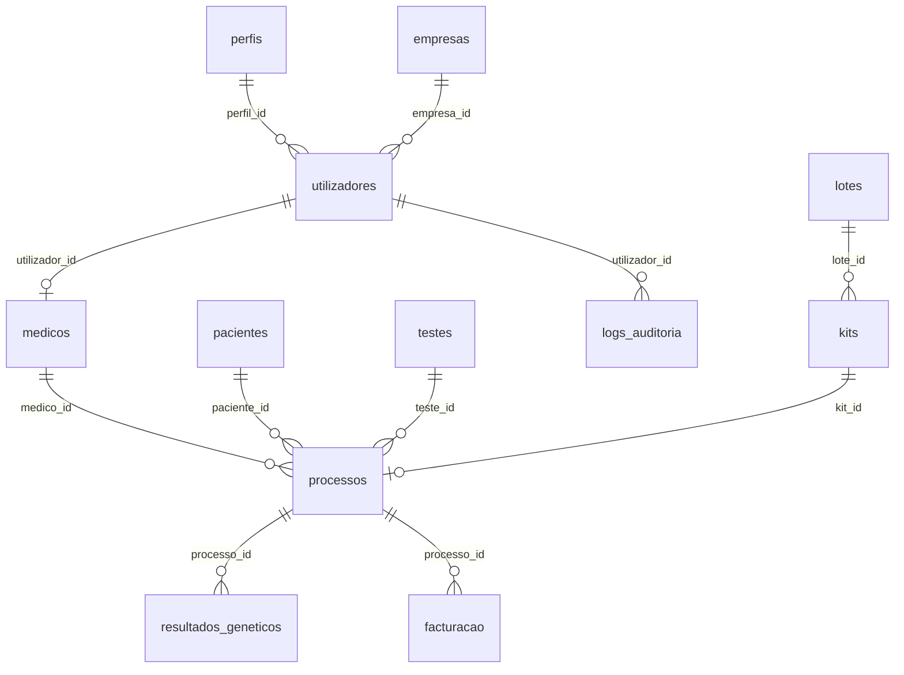

# Capítulo 4 — Database Design e Dicionário de Dados

**Projeto:** CRM Genoma  
**SGBD:** MariaDB / MySQL (InnoDB)  
**Base de Dados:** `genoma`  
**Data de Referência do Schema:** Junho de 2026  
**Fonte:** `BASE_DE_DADOS.md`, `backend/src/migrations/`

---

## 4.1. Modelo Conceptual

O modelo de dados reflecte o domínio de testes genéticos com cinco agregados principais:

1. **Identidade e Acesso** — utilizadores, perfis, permissões
2. **Contactos Clínicos** — pacientes, médicos
3. **Material e Amostras** — lotes, kits (equivalente operacional a *samples*)
4. **Processos e Resultados** — workflow clínico-laboratorial
5. **Facturação e Auditoria** — ciclo comercial e conformidade

[INSERIR DIAGRAMA ENTIDADE-RELAÇÃO (ERD) COMPLETO AQUI]

### Diagrama de Relações Simplificado (Mermaid)

---

## 4.2. Convenções do Schema

| Convenção | Descrição |
|---|---|
| Identificadores | UUID v4 em `CHAR(36)` |
| Timestamps | `created_at`, `updated_at` com `CURRENT_TIMESTAMP` |
| Soft delete | Campo `ativo TINYINT(1)` default 1 |
| Charset | `utf8mb4_unicode_ci` |
| Integridade | Foreign Keys InnoDB com `ON DELETE` conforme domínio |
| Nomenclatura | Português, snake_case |

---

## 4.3. Dicionário de Dados — Tabelas Principais

### 4.3.1. `utilizadores` (Users)

Contas de utilizador do sistema. Entidade central de autenticação e auditoria.

| Coluna | Tipo | Nulo | Chave | Default | Descrição |
|---|---|---|---|---|---|
| `id` | CHAR(36) | NÃO | PK | — | Identificador único (UUID) |
| `perfil_id` | CHAR(36) | SIM | FK → `perfis.id` | — | Perfil de acesso (RBAC) |
| `empresa_id` | CHAR(36) | SIM | FK → `empresas.id` | — | Empresa associada |
| `nome` | VARCHAR(100) | NÃO | — | — | Nome de apresentação |
| `email` | VARCHAR(100) | NÃO | UNIQUE | — | Email de login (único) |
| `telefone` | VARCHAR(20) | SIM | — | — | Contacto telefónico |
| `password_hash` | TEXT | NÃO | — | — | Hash bcrypt da password |
| `ativo` | TINYINT(1) | SIM | — | 1 | Soft delete (1=activo) |
| `created_at` | TIMESTAMP | SIM | — | CURRENT_TIMESTAMP | Data de criação |
| `reset_token_hash` | VARCHAR(128) | SIM | — | — | Hash do token de recuperação |
| `reset_token_expires_at` | DATETIME | SIM | — | — | Expiração do token de reset |
| `avatar_url` | TEXT | SIM | — | — | Foto de perfil (data URL) |

**Regras de negócio:**
- Perfil "Administrador" é único e não pode ser criado/eliminado pela interface.
- Novos utilizadores podem ser criados sem password; definem-na via "Recuperar Password".

---

### 4.3.2. `perfis` (Perfis de Acesso)

| Coluna | Tipo | Nulo | Chave | Default | Descrição |
|---|---|---|---|---|---|
| `id` | CHAR(36) | NÃO | PK | — | Identificador único |
| `nome` | VARCHAR(50) | NÃO | UNIQUE | — | Nome do perfil (ex.: Técnico, Gestão) |
| `ativo` | TINYINT(1) | SIM | — | 1 | Perfil activo |

**Valores seed:** Administrador, Gestão, Operacional (3 perfis em ambiente de desenvolvimento).

---

### 4.3.3. `kits` (Samples / Amostras Rastreáveis)

Kits individuais representam as **amostras físicas** rastreáveis por código de barras. Constituem a unidade mínima de rastreabilidade no fluxo laboratorial.

| Coluna | Tipo | Nulo | Chave | Default | Descrição |
|---|---|---|---|---|---|
| `id` | CHAR(36) | NÃO | PK | — | Identificador único |
| `numero_kit` | VARCHAR(50) | SIM | — | — | Número sequencial do kit |
| `tracking` | VARCHAR(100) | SIM | — | — | Código de tracking logístico |
| `codigo_barras` | VARCHAR(50) | NÃO | UNIQUE | — | Código de barras (identificador físico) |
| `tipo_kit_id` | CHAR(36) | SIM | FK → `testes.id` | — | Tipo de teste/kit compatível |
| `lote_id` | CHAR(36) | SIM | FK → `lotes.id` | — | Lote de origem |
| `empresa_id` | CHAR(36) | SIM | FK → `empresas.id` | — | Empresa detentora |
| `posto_id` | CHAR(36) | SIM | FK → `postos.id` | — | Posto de colheita actual |
| `status` | ENUM | SIM | INDEX | Disponivel | Estado do kit (ver valores abaixo) |
| `data_validade` | DATE | SIM | — | — | Data de expiração |
| `localizacao` | ENUM | SIM | — | Escritorio | Localização física actual |

**Valores de `status`:** `Disponivel`, `Reservado`, `Em transito`, `Utilizado`, `Invalido`, `Perdido`, `Expirado`

**Valores de `localizacao`:** `Escritorio`, `Posto`, `Laboratorio`

**Regra crítica:** Relação 1:1 com `processos` via `processos.kit_id` (índice `UNIQUE`).

---

### 4.3.4. `lotes` (Lotes de Kits)

| Coluna | Tipo | Nulo | Chave | Default | Descrição |
|---|---|---|---|---|---|
| `id` | CHAR(36) | NÃO | PK | — | Identificador único |
| `codigo_lote` | VARCHAR(50) | NÃO | UNIQUE | — | Código do lote (rastreabilidade) |
| `tipo_kit_id` | CHAR(36) | SIM | FK → `testes.id` | — | Tipo de kit do lote |
| `data_rececao` | TIMESTAMP | SIM | — | CURRENT_TIMESTAMP | Data de recepção |
| `quantidade` | INT(11) | SIM | — | 0 | Quantidade de kits gerados |
| `fornecedor_id` | CHAR(36) | SIM | FK → `empresas.id` | — | Fornecedor do material |
| `validade` | DATE | SIM | — | — | Data de validade do lote |
| `estado` | VARCHAR(30) | SIM | — | Disponivel | Estado do lote |

---

### 4.3.5. `testes` (Tests — Catálogo de Exames Genómicos)

| Coluna | Tipo | Nulo | Chave | Default | Descrição |
|---|---|---|---|---|---|
| `id` | CHAR(36) | NÃO | PK | — | Identificador único |
| `nome` | VARCHAR(100) | NÃO | — | — | Nome comercial do teste |
| `codigo` | VARCHAR(20) | SIM | — | — | Código interno |
| `categoria` | VARCHAR(80) | SIM | — | — | Categoria clínica |
| `descricao` | TEXT | SIM | — | — | Descrição do teste |
| `preco` | DECIMAL(10,2) | SIM | — | 0.00 | Preço base |
| `preco_compra` | DECIMAL(10,2) | SIM | — | 0.00 | Custo de aquisição |
| `preco_venda` | DECIMAL(10,2) | SIM | — | 0.00 | Preço de venda |
| `laboratorio_id` | CHAR(36) | SIM | FK → `empresas.id` | — | Laboratório executor |
| `tempo_estimado` | INT(11) | SIM | — | — | Tempo estimado (dias) |
| `tempo_resposta_dias` | INT(11) | SIM | — | — | SLA de resposta |
| `gestacao_minima_semanas` | INT(11) | SIM | — | — | Semanas mínimas de gestação |
| `tipo_teste` | VARCHAR(80) | SIM | — | — | Classificação do teste |
| `cromossomas` | TEXT | SIM | — | — | Cromossomas analisados |
| `delecoes_duplicacoes` | TINYINT(1) | SIM | — | 0 | Inclui análise de deleções |
| `microdelecoes_microduplicacoes` | TINYINT(1) | SIM | — | 0 | Inclui microdeleções |
| `gemeos` | TINYINT(1) | SIM | — | 0 | Suporta gravidez gemelar |
| `incluir_fracao_fetal` | TINYINT(1) | SIM | — | 1 | Inclui fração fetal |
| `ativo` | TINYINT(1) | SIM | — | 1 | Teste activo no catálogo |

---

### 4.3.6. `processos` (Processo Clínico-Laboratorial)

Entidade central do CRM. Agrega paciente, médico, kit, teste e estado do workflow.

| Coluna | Tipo | Nulo | Chave | Default | Descrição |
|---|---|---|---|---|---|
| `id` | CHAR(36) | NÃO | PK | — | Identificador único |
| `numero_processo` | VARCHAR(20) | NÃO | UNIQUE | — | Número legível do processo |
| `paciente_id` | CHAR(36) | SIM | FK → `pacientes.id` | — | Paciente/contacto |
| `medico_id` | CHAR(36) | SIM | FK → `medicos.utilizador_id` | — | Médico prescritor |
| `posto_id` | CHAR(36) | SIM | FK → `postos.id` | — | Posto de colheita |
| `kit_id` | CHAR(36) | SIM | FK → `kits.id`, UNIQUE | — | Kit/amostra (1:1) |
| `teste_id` | CHAR(36) | SIM | FK → `testes.id` | — | Tipo de teste |
| `empresa_id` | CHAR(36) | SIM | FK → `empresas.id` | — | Empresa |
| `status_id` | VARCHAR(30) | SIM | FK → `processo_status.nome` | — | Estado do workflow |
| `data_entrada` | TIMESTAMP | SIM | INDEX | CURRENT_TIMESTAMP | Data de abertura |
| `data_colheita` | DATE | SIM | — | — | Data efectiva da colheita |
| `data_chegada_laboratorio` | DATE | SIM | — | — | Recepção no laboratório |
| `data_resultado` | DATE | SIM | — | — | Data do resultado |
| `data_validacao` | DATE | SIM | — | — | Data de validação clínica |
| `data_envio_relatorio` | DATE | SIM | — | — | Data de envio do relatório |
| `relatorio_validado` | TINYINT(1) | SIM | — | 0 | Relatório validado |
| `resultado_tudo_ok` | TINYINT(1) | SIM | — | 1 | Resultado sem anomalias |
| `resultado_anomalias` | TEXT | SIM | — | — | Descrição de anomalias |
| `fatura_emitida` | TINYINT(1) | SIM | — | 0 | Fatura emitida |
| `fatura_numero` | VARCHAR(50) | SIM | — | — | Número da fatura |
| `fatura_data_emissao` | DATE | SIM | — | — | Data de emissão |
| `valor_base` | DECIMAL(10,2) | SIM | — | 0.00 | Valor base do exame |
| `desconto_percentual` | DECIMAL(5,2) | SIM | — | 0.00 | Desconto aplicado (%) |
| `valor_final` | DECIMAL(10,2) | SIM | — | 0.00 | Valor final facturado |
| `pago` | TINYINT(1) | SIM | — | 0 | Pagamento recebido |
| `pagamento_data` | DATE | SIM | — | — | Data de pagamento |
| `fracao_fetal` | VARCHAR(20) | SIM | — | — | Fração fetal detectada |
| `observacoes` | TEXT | SIM | — | — | Notas operacionais |

---

### 4.3.7. `processo_status` (Estados do Workflow)

| Coluna | Tipo | Nulo | Chave | Default | Descrição |
|---|---|---|---|---|---|
| `nome` | VARCHAR(40) | NÃO | PK | — | Nome do estado |
| `ordem` | INT(11) | NÃO | — | — | Ordem no pipeline |
| `ativo` | TINYINT(1) | SIM | — | 1 | Estado activo |

| nome | ordem |
|---|---|
| Agendado | 1 |
| Kit Reservado | 2 |
| Colheita Realizada | 3 |
| Enviado Laboratorio | 4 |
| Em Analise | 5 |
| Resultado Disponivel | 6 |
| Validado | 7 |
| Faturado | 8 |
| Cancelado | 9 |

---

### 4.3.8. `facturacao` (Invoices — Dados Complementares de Faturação)

| Coluna | Tipo | Nulo | Chave | Default | Descrição |
|---|---|---|---|---|---|
| `id` | CHAR(36) | NÃO | PK | — | Identificador único |
| `processo_id` | CHAR(36) | SIM | FK → `processos.id` | — | Processo facturado |
| `preco_teste` | DECIMAL(10,2) | SIM | — | 0.00 | Preço do teste |
| `numero_fatura` | VARCHAR(50) | SIM | — | — | Número da fatura |
| `data_fatura` | DATE | SIM | — | — | Data de emissão |
| `entidade_multibanco` | VARCHAR(20) | SIM | — | — | Entidade MB |
| `referencia_multibanco` | VARCHAR(20) | SIM | — | — | Referência MB |
| `comissao` | TINYINT(1) | SIM | — | 0 | Comissão aplicável |
| `created_at` | TIMESTAMP | SIM | — | CURRENT_TIMESTAMP | Criação |
| `updated_at` | TIMESTAMP | SIM | — | CURRENT_TIMESTAMP | Última actualização |

**Nota:** Campos de faturação também existem directamente em `processos` (`fatura_numero`, `valor_final`, etc.) para consulta rápida no workflow.

---

### 4.3.9. `logs_auditoria` (AuditLogs)

| Coluna | Tipo | Nulo | Chave | Default | Descrição |
|---|---|---|---|---|---|
| `id` | CHAR(36) | NÃO | PK | — | Identificador único |
| `empresa_id` | CHAR(36) | SIM | FK → `empresas.id` | — | Contexto empresarial |
| `utilizador_id` | CHAR(36) | SIM | FK → `utilizadores.id` | — | Utilizador que executou a acção |
| `acao` | VARCHAR(100) | SIM | — | — | Descrição da acção (ex.: CREATE, UPDATE) |
| `tabela_afetada` | VARCHAR(100) | SIM | — | — | Tabela modificada |
| `registro_id` | CHAR(36) | SIM | — | — | ID do registo afectado |
| `data` | TIMESTAMP | SIM | — | CURRENT_TIMESTAMP | Data/hora da acção |

**Registos em desenvolvimento:** 14 entradas (junho 2026).

---

## 4.4. Tabelas Satélite Relevantes

### `pacientes` (Contactos Clínicos)

| Coluna | Tipo | Nulo | Chave | Descrição |
|---|---|---|---|---|
| `id` | CHAR(36) | NÃO | PK | UUID |
| `nome` | VARCHAR(100) | NÃO | — | Nome completo |
| `data_nascimento` | DATE | NÃO | — | Data de nascimento |
| `genero` | VARCHAR(20) | SIM | — | Género |
| `nif` | VARCHAR(20) | SIM | UNIQUE | NIF (dado pessoal — RGPD) |
| `telemovel` | VARCHAR(20) | SIM | — | Telemóvel |
| `email` | VARCHAR(100) | SIM | — | Email |
| `morada` | TEXT | SIM | — | Morada |
| `altura` | DECIMAL(5,2) | SIM | — | Altura (m) |
| `peso` | DECIMAL(5,2) | SIM | — | Peso (kg) |
| `ativo` | TINYINT(1) | SIM | — | Soft delete |

### `resultados_geneticos`

| Coluna | Tipo | Nulo | Chave | Descrição |
|---|---|---|---|---|
| `id` | CHAR(36) | NÃO | PK | UUID |
| `processo_id` | CHAR(36) | SIM | FK | Processo associado |
| `cromossoma` | VARCHAR(10) | SIM | — | Cromossoma analisado |
| `resultado_valor` | VARCHAR(50) | SIM | — | Valor do resultado |
| `probabilidade` | VARCHAR(50) | SIM | — | Probabilidade estatística |
| `tipo_resultado` | VARCHAR(20) | SIM | — | Classificação |

### `colheitas` (Agendamentos)

| Coluna | Tipo | Nulo | Chave | Descrição |
|---|---|---|---|---|
| `id` | CHAR(36) | NÃO | PK | UUID |
| `processo_id` | CHAR(36) | SIM | FK | Processo |
| `posto_id` | CHAR(36) | SIM | FK | Posto de colheita |
| `data_prevista` | DATE | SIM | INDEX | Data agendada |
| `periodo` | ENUM | SIM | — | Manhã / Tarde / Noite |
| `data_efetiva` | DATETIME | SIM | — | Data real da colheita |

---

## 4.5. Índices e Constraints Críticas

| Constraint | Tabela | Impacto |
|---|---|---|
| `UNIQUE (codigo_barras)` | `kits` | Impede duplicação de amostras |
| `UNIQUE (kit_id)` | `processos` | Garante relação 1:1 kit-processo |
| `UNIQUE (numero_processo)` | `processos` | Identificador legível único |
| `UNIQUE (email)` | `utilizadores` | Um email por conta |
| `FK processos.status_id` | `processos` | Integridade do workflow |
| `idx_processos_data_entrada` | `processos` | Performance em listagens por data |
| `idx_processos_status` | `processos` | Performance no pipeline Kanban |

---

## 4.6. Normalização

O schema encontra-se predominantemente em **3ª Forma Normal (3FN)**:

- Dados de faturação duplicados entre `processos` e `facturacao` constituem uma **desnormalização controlada** para performance de consulta no workflow (trade-off documentado).
- Tabela `pedidos_exames` é **legada** e mantida apenas para compatibilidade retroativa.

---

## 4.7. Estatísticas do Schema (Ambiente de Desenvolvimento)

| Métrica | Valor |
|---|---|
| Total de tabelas | 29 |
| Migrações aplicadas | 59 |
| Perfis configurados | 3 |
| Testes no catálogo | 3 |
| Kits registados | 4 |
| Lotes registados | 3 |
| Registos de auditoria | 14 |

---

## 4.8. Evolução Recente do Schema (Migrações 057–059)

| Migração | Descrição |
|---|---|
| `057_processo_data_envio_laboratorio.js` | Campo `data_envio_laboratorio` distinto da recepção no laboratório |
| `058_backfill_processo_colheita_snapshot.js` | Backfill e preservação do snapshot de colheita no processo |
| `059_empresa_notas_morada_extra.js` | Colunas `cidade`, `distrito`, `notas` na tabela `empresas` |

---

## Referências

- `BASE_DE_DADOS.md` — Documentação completa das 29 tabelas
- `backend/src/migrations/000_create_base_tables.js` — Schema inicial
- `backend/src/migrations/001_create_logs.js` — Tabela de auditoria
