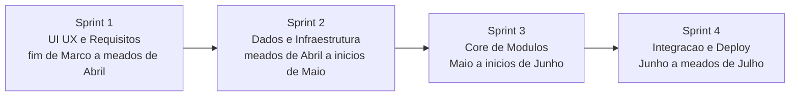
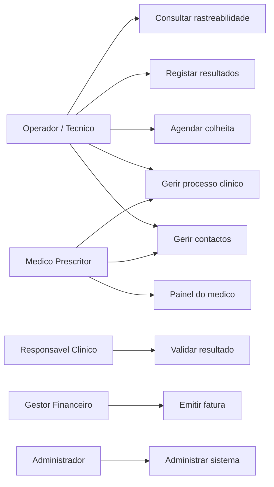
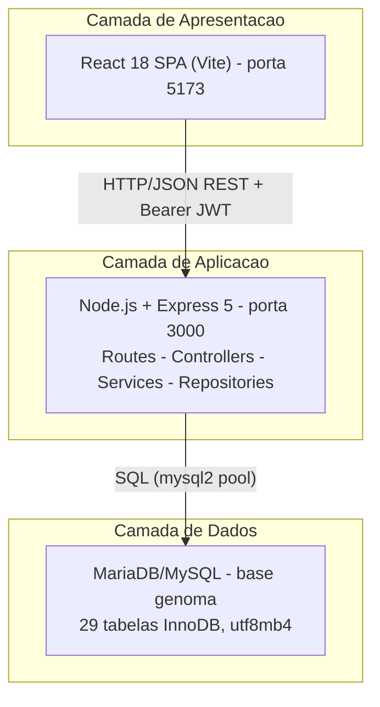
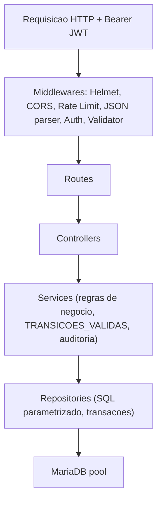
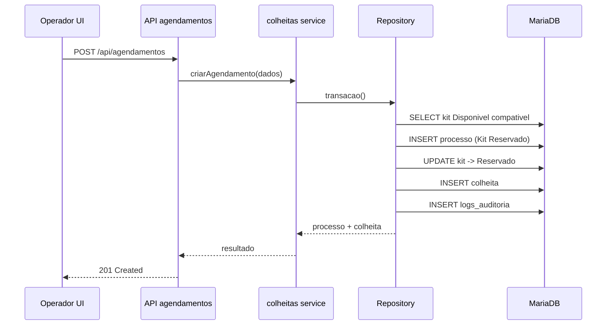
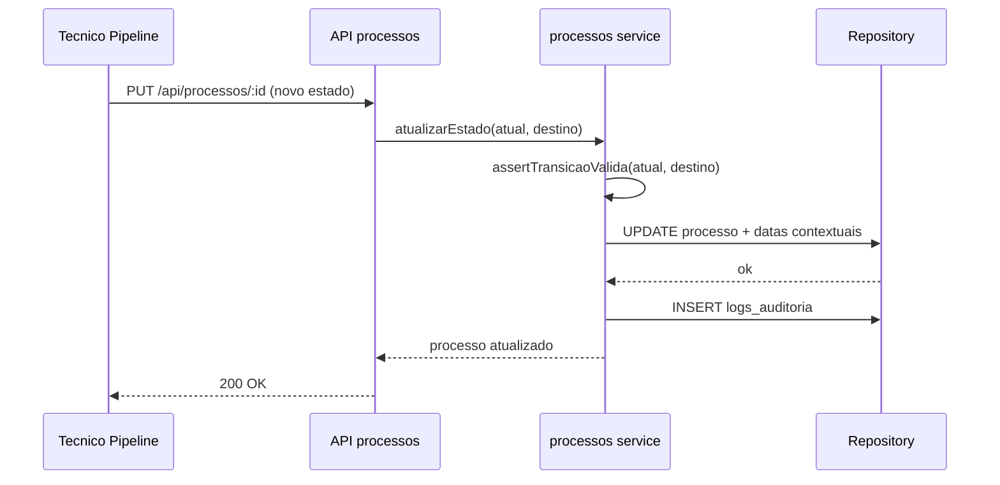
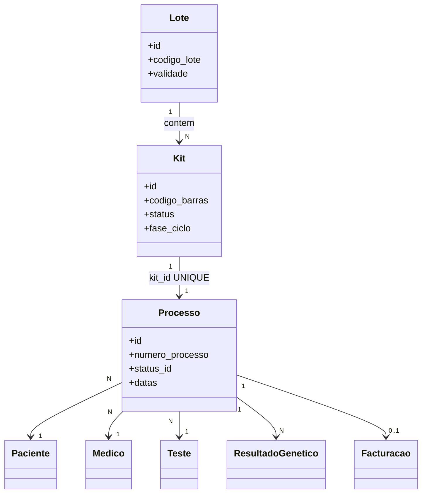
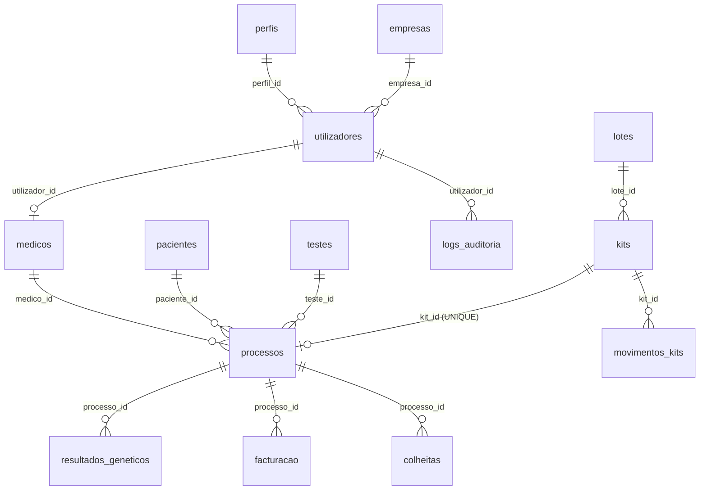
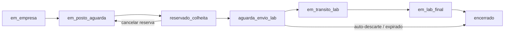
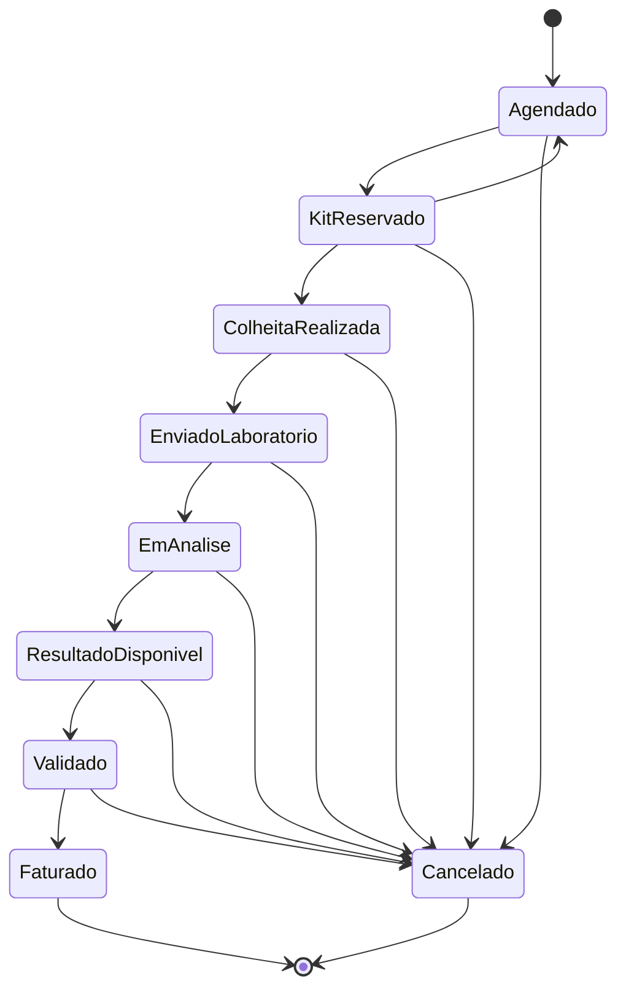

# Licenciatura em Engenharia Informática

---

**CRM Genoma — Sistema de Gestão Operacional de Testes Genéticos**

*Reengenharia de um sistema de informação clínico-laboratorial (ex-Stemyca)*

**Rafael Fernandes Males** — a22212343

**Alberto Macieira** — a22301601

Ana Paula *(Orientadora)*

ISLA — Instituto Superior de Línguas e Administração
Campus de Vila Nova de Gaia

Ano Lectivo 2025/2026 — Julho de 2026

---

## Dedicatória

À nossa família, aos amigos e à equipa da Genoma, pelo apoio, confiança e partilha de conhecimento ao longo deste percurso académico e profissional. Dedicamos igualmente este trabalho a todos os profissionais de saúde que, diariamente, dependem de sistemas de informação fiáveis para cuidar de quem mais precisa.

---

## Resumo

A **Genoma** — organização anteriormente denominada **Stemyca** — dedica-se à prestação de serviços de diagnóstico genómico, acompanhando cada amostra biológica desde a recepção do material até à emissão do relatório clínico e à faturação final. A necessidade de reengenharia do sistema de informação nasceu de uma limitação crítica do software legado: tratava-se de uma aplicação de instalação local, operável exclusivamente a partir do único computador onde estava instalada e acessível apenas através de uma conta de administrador, sem suporte a perfis de utilizador diferenciados. Com a descontinuação do produto por parte do fornecedor, a organização ficou sem margem de evolução, sem gestão de acessos e sem rastreabilidade adequada ao contexto de diagnóstico genético e à conformidade com o Regulamento Geral sobre a Protecção de Dados (RGPD).

O presente relatório documenta o projecto de desenvolvimento do **CRM Genoma**, uma aplicação web full-stack concebida para digitalizar, centralizar e modernizar a operação clínico-laboratorial da organização. O trabalho, realizado em equipa segundo uma metodologia ágil (Scrum) entre o final de Março e meados de Julho de 2026, incluiu o levantamento de requisitos junto de stakeholders, a modelação de uma arquitectura Three-Tier com API REST, o desenho de uma base de dados relacional evolutiva controlada por sessenta e três migrações versionadas, a implementação de um workflow rigoroso suportado por uma máquina de estados finita, e módulos de stocks, agendamentos, relatórios exportáveis, administração e auditoria. A solução adopta React 18 com TypeScript e Vite no frontend, Node.js com Express 5 no backend e MariaDB/MySQL como sistema de gestão de base de dados, complementada por autenticação JWT, controlo de acessos baseado em perfis (RBAC), isolamento lógico de dados por médico prescritor e registo de acções em `logs_auditoria`.

Conclui-se que o CRM Genoma constitui uma base sólida e viável para a gestão operacional de testes genéticos, ultrapassando por completo as limitações do sistema legado: substitui a instalação monoposto por uma aplicação web multiutilizador com perfis diferenciados, garante rastreabilidade ponta a ponta (lote → kit → processo → resultado → faturação) e prepara a organização para evoluções futuras, nomeadamente a integração com software de faturação certificado e a activação de canais de notificação externos.

**Palavras-chave:** testes genéticos; CRM; reengenharia de software; rastreabilidade; arquitectura Three-Tier; React; Node.js; MariaDB; RGPD; Scrum.

---

## Agradecimentos

Agradecemos à orientadora **Ana Paula**, pelo acompanhamento académico, pela orientação metodológica e pelo feedback construtivo ao longo da elaboração deste projecto.

À **equipa Genoma (ex-Stemyca)**, em particular aos intervenientes que participaram nas sessões de levantamento de requisitos e ao estagiário que assegurou o acesso à infraestrutura de dados legada, pela disponibilidade em partilhar o conhecimento do fluxo operacional real e em validar as decisões de concepção do sistema.

Ao **Instituto Superior de Línguas e Administração (ISLA)**, pelos conhecimentos transmitidos ao longo da Licenciatura em Engenharia Informática, que permitiram abordar este projecto com rigor técnico e académico.

Por fim, aos colegas de equipa, pela colaboração, pela partilha de responsabilidades e pela resiliência demonstrada perante as dependências e os prazos exigentes de um projecto de grupo.

---

## Índice

| Secção | Página |
| --- | --- |
| Resumo | v |
| Agradecimentos | vii |
| Índice | ix |
| Índice de figuras | xi |
| Índice de tabelas | xii |
| **1. Introdução** | **1** |
| 1.1 Enquadramento e Motivação (da Stemyca à Genoma) | 1 |
| 1.2 O Sistema Legado e as suas Limitações | 2 |
| 1.3 Objectivos do Projecto | 3 |
| 1.4 A Equipa e a Divisão do Trabalho | 4 |
| 1.5 Organização do Relatório | 5 |
| **2. Metodologia Ágil e Gestão do Projecto** | **6** |
| 2.1 Adopção do Scrum | 6 |
| 2.2 Cronograma e Sprints (Março a Julho) | 7 |
| 2.3 Matriz de Responsabilidades (RACI) | 9 |
| 2.4 Gestão de Dependências e Riscos | 11 |
| **3. Análise do Problema e Engenharia de Requisitos** | **12** |
| 3.1 Relatório de Viabilidade | 12 |
| 3.2 Entrevistas a Stakeholders | 14 |
| 3.3 User Stories | 15 |
| 3.4 Requisitos Funcionais | 17 |
| 3.5 Requisitos Não Funcionais | 20 |
| **4. Concepção da Solução e Arquitectura** | **22** |
| 4.1 Diagrama de Casos de Uso | 22 |
| 4.2 Arquitectura Three-Tier | 23 |
| 4.3 Padrão em Camadas do Backend | 25 |
| 4.4 Diagramas de Sequência e Actividades | 26 |
| 4.5 Diagrama de Classes | 28 |
| 4.6 Decisões Arquitectónicas (ADR) | 29 |
| **5. Evolução da Base de Dados** | **30** |
| 5.1 Modelo Conceptual e ER | 30 |
| 5.2 Dicionário de Dados | 31 |
| 5.3 Pipeline das 63 Migrações | 34 |
| 5.4 Integridade, Normalização e Ciclo de Vida do Kit | 36 |
| **6. Engenharia de Frontend (Rafael Males)** | **38** |
| 6.1 Do Figma ao Código e Identidade Visual | 38 |
| 6.2 Gestão de Estado Global (DataContext) | 39 |
| 6.3 Internacionalização e Modo Escuro | 40 |
| 6.4 Módulos Globais de Sistema | 41 |
| **7. Módulos de Negócio** | **43** |
| 7.1 Contactos e Pacientes (Rafael) | 43 |
| 7.2 Processos Clínicos (Rafael → Alexandre e Daniel) | 44 |
| 7.3 Stock e Ciclo de Vida do Inventário (Alberto e Rafael) | 45 |
| 7.4 Motor de Relatórios e Listagens (Alberto) | 47 |
| **8. Workflow e Máquina de Estados** | **48** |
| **9. Segurança, RGPD e Isolamento por Médico** | **50** |
| **10. Verificação e Validação** | **52** |
| **11. Conclusões e Trabalho Futuro** | **55** |
| **12. Referências e Bibliografia** | **57** |
| **ANEXO A — User Stories Completas** | 58 |
| **ANEXO B — Casos de Teste Detalhados** | 62 |
| **ANEXO C — Matriz RACI Alargada** | 66 |
| **ANEXO D — Catálogo das 63 Migrações** | 68 |

---

## Índice de figuras

| Figura | Legenda | Página |
| --- | --- | --- |
| Figura 1 | Fluxo operacional do CRM Genoma (Lote → Faturação) | 2 |
| Figura 2 | Comparação sistema legado (monoposto) vs. CRM Genoma (web) | 3 |
| Figura 3 | Cronograma de Sprints (Gantt) | 8 |
| Figura 4 | Diagrama de Casos de Uso | 22 |
| Figura 5 | Arquitectura Three-Tier | 24 |
| Figura 6 | Fluxo em camadas de uma requisição | 25 |
| Figura 7 | Sequência — Agendamento com reserva de kit | 27 |
| Figura 8 | Sequência — Transição de estado do processo | 27 |
| Figura 9 | Actividades — Ciclo de vida do kit | 37 |
| Figura 10 | Diagrama de Classes do domínio operacional | 28 |
| Figura 11 | Diagrama Entidade-Relacionamento simplificado | 30 |
| Figura 12 | Máquina de estados do processo | 48 |

---

## Índice de tabelas

| Tabela | Legenda | Página |
| --- | --- | --- |
| Tabela 1 | Limitações do legado e resposta do CRM Genoma | 2 |
| Tabela 2 | Sprints e objectivos | 7 |
| Tabela 3 | Matriz RACI resumida | 10 |
| Tabela 4 | Requisitos Funcionais (RF-001 a RF-020) | 18 |
| Tabela 5 | Requisitos Não Funcionais | 20 |
| Tabela 6 | Stack tecnológico e versões | 23 |
| Tabela 7 | Estados do workflow (`processo_status`) | 48 |
| Tabela 8 | Transições válidas | 49 |
| Tabela 9 | Casos de teste e cobertura | 53 |

---

## 1. Introdução

Este capítulo apresenta o contexto do projecto **CRM Genoma**, a motivação que justifica a sua realização, os objectivos definidos, a composição da equipa e a organização do presente relatório. O projecto insere-se no âmbito da Licenciatura em Engenharia Informática do ISLA e documenta a concepção e a implementação de um sistema de informação orientado ao domínio clínico-laboratorial de testes genéticos, desenvolvido para uma organização real do sector da saúde.

### 1.1. Enquadramento e Motivação (da Stemyca à Genoma)

A organização cliente — hoje designada **Genoma** e anteriormente conhecida como **Stemyca** — presta serviços de diagnóstico genómico, com particular incidência em testes pré-natais não invasivos e em análises cromossómicas. O seu fluxo operacional acompanha cada amostra biológica ao longo de uma cadeia bem definida: recepção do material (kit), agendamento e realização da colheita, envio ao laboratório, análise, disponibilização e validação clínica do resultado, emissão do relatório e, por fim, faturação. Este percurso pode sintetizar-se da seguinte forma:

```
Lote → Kit → Agendamento → Colheita → Processo → Resultado → Relatório → Faturação
```

**Figura 1** — Fluxo operacional do CRM Genoma (Lote → Faturação).

A mudança de identidade empresarial, de Stemyca para Genoma, acompanhou uma reorganização interna e uma ambição de crescimento que o sistema de informação existente já não conseguia suportar. Foi neste contexto que a organização solicitou a uma equipa de estudantes de Engenharia Informática a **reengenharia completa do seu CRM**, transformando uma ferramenta genérica e obsoleta num sistema operacional moderno, seguro e alinhado com o fluxo real de trabalho.

Para os autores, este projecto representa uma mais-valia significativa: além do rigor académico exigido por um projecto de fim de curso, proporciona experiência de desenvolvimento em contexto empresarial real, com um cliente, prazos, dependências entre elementos da equipa e requisitos de conformidade — um conjunto de competências e uma referência de projecto de elevado valor para a integração no mercado de trabalho e para o enriquecimento do currículo profissional.

### 1.2. O Sistema Legado e as suas Limitações

O software utilizado pela Stemyca era uma aplicação de **instalação local (desktop)**, caracterizada por um conjunto de limitações estruturais que motivaram a sua substituição. Estas limitações não constituíam apenas incómodos operacionais: representavam riscos concretos de continuidade de negócio, de segurança e de conformidade regulatória.

| Limitação do sistema legado (Stemyca) | Impacto operacional | Resposta do CRM Genoma |
| --- | --- | --- |
| Aplicação instalada num único computador | Operação dependente de uma máquina física; indisponibilidade em caso de avaria | Aplicação web acessível de qualquer posto autorizado |
| Acesso exclusivo pela conta de administrador | Ausência de responsabilização individual; partilha de credenciais | Autenticação individual (JWT) e conta por utilizador |
| Inexistência de perfis de utilizador diferenciados | Todos viam e faziam tudo; sem separação de funções | RBAC por perfis (`perfis`, `perfil_stock_submodulos`) e isolamento por médico |
| Produto descontinuado pelo fornecedor | Sem correcções, sem evolução, sem suporte | Código próprio, versionado e evolutivo (63 migrações) |
| Rastreabilidade limitada | Dificuldade em responder a auditorias e recalls | Rastreabilidade bidireccional (`/api/trace`) |
| Ausência de auditoria de acções | Impossível saber quem alterou o quê | `logs_auditoria` centralizado |

**Tabela 1** — Limitações do legado e resposta do CRM Genoma.

**Figura 2** — Comparação entre o sistema legado (monoposto, administrador único) e o CRM Genoma (aplicação web multiutilizador com perfis).

O elemento mais crítico era a conjugação de dois factores: por um lado, a aplicação só podia ser utilizada no computador onde se encontrava instalada; por outro, o acesso estava confinado ao perfil de administrador, sem possibilidade de criar contas distintas para rececionistas, técnicos, responsáveis clínicos ou gestão financeira. Somando-se a descontinuação do produto, a organização enfrentava um cenário de dependência total de uma única máquina e de uma única conta, sem qualquer garantia de evolução futura. A reengenharia para uma arquitectura web multiutilizador respondeu directamente a este problema, sendo o factor determinante para o arranque do projecto.

### 1.3. Objectivos do Projecto

**Objectivo geral:** desenvolver um sistema de informação web que suporte integralmente a gestão operacional de testes genéticos na Genoma, desde a recepção de amostras até à faturação, com rastreabilidade, segurança de dados, conformidade regulatória e acesso multiutilizador diferenciado por perfil.

**Objectivos específicos:**

1. Analisar o domínio clínico-laboratorial e identificar requisitos funcionais e não funcionais junto dos stakeholders da organização.
2. Substituir a aplicação monoposto legada por uma arquitectura Three-Tier / API-Based escalável, de fácil manutenção e acessível em rede.
3. Modelar uma base de dados relacional que reflicta as entidades, as relações e as regras de integridade do domínio genómico, evoluída de forma controlada por migrações versionadas.
4. Implementar um workflow de processos com máquina de estados finita e transições validadas no servidor.
5. Desenvolver módulos de stocks com ciclo de vida de inventário, agendamentos, relatórios exportáveis e administração com controlo de acessos baseado em perfis (RBAC).
6. Assegurar a segurança e a conformidade com o RGPD através de autenticação, cifragem de credenciais, auditoria e isolamento lógico de dados sensíveis.
7. Definir casos de teste e uma matriz de rastreabilidade que assegurem a cobertura dos requisitos críticos.
8. Documentar a solução de modo a permitir a sua evolução futura e a transição segura para produção.

### 1.4. A Equipa e a Divisão do Trabalho

O projecto foi desenvolvido por uma equipa de quatro estudantes, com o apoio pontual de um estagiário da organização cliente. A divisão do trabalho procurou aproveitar as competências de cada elemento, mantendo o equilíbrio próprio de um projecto de grupo académico. Os dois autores deste relatório — Rafael Fernandes Males (a22212343) e Alberto Macieira (a22301601) — assumiram a espinha dorsal técnica da solução, cobrindo o motor visual e de interacção, a camada de persistência e a lógica de negócio dos módulos centrais.

- **Rafael Fernandes Males (a22212343)** foi responsável pelo motor visual e pela experiência de utilizador, pela arquitectura de persistência e por desbloquear componentes críticos do sistema. Concebeu o protótipo de alta fidelidade em Figma e transpô-lo integralmente para código, criou a identidade visual (logótipos em `.png` e `.ico`, elaborados em Photopea), implementou a totalidade da interface (React 18 + TypeScript + Vite, com Shadcn UI/Radix/Tailwind e animações), desenvolveu os módulos globais de sistema (Modo Escuro nativo, Pesquisa Global indexada, Notificações in-app, Definições de Conta e o módulo de Administração), assumiu o resgate integral do módulo de Contactos/Pacientes e desenhou a arquitectura inicial e os fluxos visuais do pipeline de Processos Clínicos. Foi ainda co-autor da arquitectura de dados e o responsável directo pela criação, escrita e execução do pipeline das 63 migrações.
- **Alberto Macieira (a22301601)** trabalhou em estreita cooperação com o Rafael na camada de dados e na lógica de negócio. Desenvolveu, em regime de *pair programming* com o Rafael, a Gestão de Inventário (Stock), incluindo a lógica de lotes, kits e as regras estritas de ciclo de vida do inventário médico. De forma autónoma, desenvolveu o motor de Relatórios (antigas Listagens), com listagens dinâmicas, filtros avançados e exportação de dados analíticos. Actuou também como co-autor na modelação do esquema relacional e na estruturação das migrações.
- **Alexandre e Daniel** ficaram inicialmente encarregues do levantamento de requisitos analíticos e da arquitectura teórica do módulo de Contactos e, na fase de fecho, assumiram em exclusivo a finalização e a codificação final do módulo de Processos Clínicos, integrando os requisitos de fluxo pretendidos pelo cliente.
- **Estagiário da empresa (elemento externo)** actuou como pivot técnico dentro da organização cliente, sendo o responsável por aceder à infraestrutura da base de dados antiga, extrair os registos históricos e realizar uma fase inicial de limpeza de dados (*data cleansing*), entregando à equipa uma base de dados inicial mitigada.

A secção 2.3 detalha esta divisão numa matriz de responsabilidades (RACI) cruzada com as fases do projecto.

### 1.5. Organização do Relatório

| Capítulo | Conteúdo |
| --- | --- |
| **Capítulo 2** | Metodologia ágil (Scrum), cronograma em sprints, matriz RACI e gestão de riscos e dependências |
| **Capítulo 3** | Análise do problema: viabilidade, entrevistas, user stories e requisitos funcionais e não funcionais |
| **Capítulo 4** | Concepção da solução: casos de uso, arquitectura Three-Tier, padrão em camadas, diagramas e decisões arquitectónicas |
| **Capítulo 5** | Evolução da base de dados: modelo ER, dicionário de dados, pipeline de migrações e ciclo de vida do kit |
| **Capítulo 6** | Engenharia de frontend: identidade visual, gestão de estado, internacionalização, modo escuro e módulos globais |
| **Capítulo 7** | Módulos de negócio: Contactos, Processos, Stock e Relatórios |
| **Capítulos 8 e 9** | Workflow com máquina de estados; segurança, RGPD e isolamento por médico |
| **Capítulo 10** | Verificação e validação: casos de teste e matriz de rastreabilidade |
| **Capítulos 11 e 12** | Conclusões, trabalho futuro e referências |
| **Anexos A a D** | User stories, casos de teste, matriz RACI alargada e catálogo das migrações |

---

## 2. Metodologia Ágil e Gestão do Projecto

Este capítulo descreve a metodologia de gestão adoptada, o cronograma organizado em sprints, a distribuição de responsabilidades e a forma como a equipa geriu as dependências e os riscos inerentes a um projecto de grupo com um cliente real.

### 2.1. Adopção do Scrum

Dada a natureza evolutiva dos requisitos — em parte descobertos ao longo do contacto com a organização — e a necessidade de coordenar quatro elementos com responsabilidades interdependentes, a equipa adoptou uma abordagem **ágil inspirada no Scrum**. Esta escolha privilegiou a entrega incremental de valor, a revisão periódica do progresso e a capacidade de adaptação face a alterações de âmbito e a bloqueios de dependências.

Os elementos do processo aplicados foram:

- **Product Backlog** — conjunto de user stories e requisitos derivados das entrevistas e da análise do sistema legado, priorizados por valor operacional (ver Capítulo 3).
- **Sprints** — ciclos de trabalho de duração aproximadamente quinzenal, cada um com um objectivo (*sprint goal*) e um conjunto de itens do backlog seleccionados.
- **Sprint Planning** — reunião de planeamento no início de cada sprint, para selecção e estimativa dos itens.
- **Daily Sync** — pontos de sincronização curtos e frequentes entre os elementos, essenciais para desbloquear dependências (nomeadamente quando o avanço de um módulo dependia do trabalho de outro colega).
- **Sprint Review e Retrospectiva** — revisão do incremento com foco na validação junto do cliente e reflexão sobre melhorias de processo.

A adopção formal do Scrum trouxe disciplina a um desenvolvimento que, pela pressão dos prazos e pela interdependência de tarefas, poderia facilmente tornar-se desorganizado. A estruturação em sprints e a clarificação de responsabilidades permitiram absorver o resgate de módulos atrasados sem comprometer o objectivo global.

### 2.2. Cronograma e Sprints (Março a Julho)

O projecto decorreu entre o **final de Março** e **meados de Julho de 2026**, com data-limite de entrega a **16/17 de Julho** e apresentação oficial a **21 de Julho**. O trabalho foi organizado em quatro sprints principais, conforme a tabela seguinte.

| Sprint | Período (aprox.) | Objectivo (Sprint Goal) | Principais entregas |
| --- | --- | --- | --- |
| **Sprint 1** | Final de Março a meados de Abril | UI/UX e Requisitos | Protótipo Figma, identidade visual, levantamento de requisitos, user stories, base do frontend |
| **Sprint 2** | Meados de Abril a inícios de Maio | Engenharia de Dados e Infraestrutura | Modelo relacional, pipeline de migrações, API base (Express), autenticação JWT |
| **Sprint 3** | Maio a inícios de Junho | Desenvolvimento Core de Módulos | Contactos, Stock, Processos, Relatórios, Administração |
| **Sprint 4** | Junho a meados de Julho | Integração, Resgate de Dependências e Deploy | Fecho do módulo de Processos, isolamento por médico, auto-descartes, notificações, validação e preparação da entrega |

**Tabela 2** — Sprints e objectivos.

A tabela de cronograma seguinte representa a distribuição temporal das actividades ao longo dos quatro sprints, com datas de início e fim aproximadas e a respectiva duração.

| Sprint | Actividade | Início | Fim | Duração |
| --- | --- | --- | --- | --- |
| **S1** | Protótipo Figma e identidade visual | 24/03/2026 | 11/04/2026 | 18 dias |
| **S1** | Levantamento de requisitos | 28/03/2026 | 13/04/2026 | 16 dias |
| **S1** | Base do frontend (React/Vite) | 05/04/2026 | 17/04/2026 | 12 dias |
| **S2** | Modelo relacional e migrações | 15/04/2026 | 01/05/2026 | 16 dias |
| **S2** | API base e autenticação JWT | 20/04/2026 | 04/05/2026 | 14 dias |
| **S3** | Contactos e Pacientes | 01/05/2026 | 19/05/2026 | 18 dias |
| **S3** | Stock e ciclo de vida do kit | 05/05/2026 | 25/05/2026 | 20 dias |
| **S3** | Relatórios e Listagens | 12/05/2026 | 28/05/2026 | 16 dias |
| **S3** | Processos e Administração | 15/05/2026 | 02/06/2026 | 18 dias |
| **S4** | Fecho dos Processos Clínicos | 05/06/2026 | 25/06/2026 | 20 dias |
| **S4** | Isolamento por médico e auditoria | 10/06/2026 | 25/06/2026 | 15 dias |
| **S4** | Auto-descartes e notificações | 18/06/2026 | 30/06/2026 | 12 dias |
| **S4** | Validação e preparação da entrega | 01/07/2026 | 17/07/2026 | 16 dias |

**Figura 3** — Cronograma de Sprints (Março a Julho de 2026).

O diagrama seguinte resume, de forma sequencial, o encadeamento dos quatro sprints.



### 2.3. Matriz de Responsabilidades (RACI)

A matriz RACI (Responsible, Accountable, Consulted, Informed) foi utilizada para clarificar, para cada área de trabalho, quem executa (R), quem é responsável pelo resultado (A), quem é consultado (C) e quem é informado (I). A tabela seguinte apresenta uma versão resumida; a versão alargada, cruzada com os sprints, consta do Anexo C.

| Área / Entregável | Rafael (a22212343) | Alberto (a22301601) | Alexandre e Daniel | Estagiário |
| --- | --- | --- | --- | --- |
| UI/UX e Design System | A/R | C | I | I |
| Identidade visual (logótipos) | A/R | I | I | — |
| Frontend core (React/TS/Vite) | A/R | C | C | — |
| Módulos globais (Dark Mode, Pesquisa, Notificações, Definições, Administração) | A/R | I | I | — |
| Contactos / Pacientes | A/R | C | C | I |
| Processos Clínicos (arquitectura) | A/R | C | C | I |
| Processos Clínicos (fecho e codificação final) | C | C | A/R | I |
| Stock / Inventário e ciclo de vida | R | A/R | I | I |
| Relatórios / Listagens e exportação | C | A/R | I | I |
| Modelação relacional e migrações | A/R | R | C | C |
| Extracção e limpeza de dados legados | I | C | I | A/R |

**Tabela 3** — Matriz RACI resumida.

Esta matriz evidencia a centralidade dos dois autores na execução técnica: o Rafael como principal responsável pela camada de apresentação, pelos módulos globais e pelo pipeline de dados, e o Alberto como responsável pelo Stock (em co-execução) e pelo motor de Relatórios (de forma autónoma). O módulo de Processos ilustra bem a natureza colaborativa e sequencial do trabalho: a sua arquitectura e fluxos visuais foram estabelecidos pelo Rafael, sendo o fecho e a codificação final assumidos pelo Alexandre e pelo Daniel.

### 2.4. Gestão de Dependências e Riscos

Um projecto de grupo com módulos interdependentes está sujeito a riscos de bloqueio: o atraso de um elemento pode paralisar o trabalho de outro. A equipa mitigou estes riscos através de três mecanismos: (1) a definição de contratos de interface claros entre módulos (tipos TypeScript partilhados e contratos de API estáveis), que permitiram trabalhar em paralelo; (2) a sincronização diária, que tornava os bloqueios visíveis cedo; e (3) a redistribuição pragmática de tarefas quando necessário — de que o resgate do módulo de Contactos pelo Rafael é o exemplo mais relevante.

| Risco | Probabilidade | Impacto | Mitigação |
| --- | --- | --- | --- |
| Atraso de dependências entre elementos | Alta | Alto | Contratos de interface; redistribuição de tarefas (resgate de Contactos) |
| Requisitos incompletos do cliente | Média | Alto | Documento de perguntas e validação iterativa por sprint |
| Complexidade do ciclo de vida do inventário | Média | Médio | Modelação explícita de fases (`fase_ciclo`) e pair programming |
| Conformidade RGPD | Baixa | Alto | RBAC, auditoria, soft-delete e isolamento por médico |
| Integração de faturação certificada | Média | Médio | API modular; campos já modelados para integração posterior |

---

## 3. Análise do Problema e Levantamento de Requisitos

Este capítulo apresenta a análise de viabilidade, a metodologia de recolha de requisitos junto de stakeholders, as user stories derivadas e o levantamento formal de requisitos funcionais (RF) e não funcionais (RNF).

### 3.1. Relatório de Viabilidade

#### 3.1.1. Viabilidade Técnica

Para a reengenharia do CRM Genoma foram seleccionadas tecnologias modernas, estáveis e amplamente adoptadas, garantindo compatibilidade, desempenho e escalabilidade — em contraste directo com a rigidez do sistema legado.

| Camada | Tecnologia | Justificação |
| --- | --- | --- |
| Apresentação | React 18 + Vite 6 + TypeScript | SPA reactiva, componentização modular, tipagem estática |
| API REST | Node.js ≥ 18 + Express 5 | Ecossistema maduro; adequado a CRUD e workflows transaccionais |
| Persistência | MariaDB/MySQL (InnoDB) | Transacções ACID; integridade referencial; UUIDs |
| Autenticação | JWT + bcrypt | Stateless; padrão de mercado; multiutilizador |
| Segurança HTTP | Helmet, CORS, express-rate-limit | Mitigação de XSS, brute-force e abuso |

O domínio genómico impõe requisitos técnicos específicos já contemplados na implementação:

1. **Máquina de estados finita** — transições validadas em `backend/src/services/processos.service.js` (`TRANSICOES_VALIDAS`).
2. **Rastreabilidade bidireccional** — módulo `/api/trace` (lote ↔ kit ↔ processo ↔ resultado).
3. **Integridade 1:1 kit-processo** — índice `UNIQUE` em `processos.kit_id`.
4. **Ciclo de vida do inventário** — fases explícitas em `backend/src/config/kit-lifecycle.js` e auto-descartes automáticos.
5. **Auditoria centralizada** — tabela `logs_auditoria` com registo de acções.
6. **Migrações versionadas** — 63 ficheiros em `backend/src/migrations/` (000 a 063).

**Conclusão:** viável. O código existente demonstra uma solução operacional com 29 tabelas, mais de 20 grupos de endpoints REST e módulos frontend a compilar sem erros.

#### 3.1.2. Viabilidade Operacional

A plataforma reflecte o pipeline validado com o cliente, com nove estados de processo (ver Tabela 7). A automatização da reserva de kits no agendamento, a impossibilidade de saltar estados e a centralização de listagens reduzem erros manuais. Os perfis configuráveis (`perfis`, `perfil_stock_submodulos`) permitem adaptar a interface a rececionistas, técnicos, responsáveis clínicos e gestão financeira — resolvendo directamente a ausência de perfis do sistema legado.

**Conclusão:** viável, condicionada à validação final de regras de negócio em ambiente real.

#### 3.1.3. Viabilidade Económica

| Factor | Análise |
| --- | --- |
| Custos de licenciamento | 0 € — stack open-source (React, Node.js, MariaDB) |
| Custos de desenvolvimento | Tempo de projecto académico (sem custo directo de licenças) |
| Custos operacionais | Hosting, base de dados gerida, eventual SMS/e-mail transaccional |
| Benefícios | Fim da dependência de máquina única; multiutilizador; rastreabilidade; reporting centralizado |

A utilização de tecnologias open-source minimiza as despesas iniciais, tornando o projecto financeiramente sustentável para uma PME do sector da saúde.

### 3.2. Entrevistas a Stakeholders

As entrevistas semi-estruturadas permitiram recolher informação directa junto de médicos prescritores, directores de laboratório, administradores e técnicos de recepção. O guião organizou as questões por áreas temáticas: fluxo operacional; agendamentos; resultados e faturação; notificações; stocks; permissões e RGPD; e dados e arranque. As principais conclusões foram:

- A sequência de estados implementada corresponde ao fluxo real, pendente de validação final dos motivos de anulação.
- A reserva automática de kit no agendamento é considerada essencial para evitar colheitas sem material.
- A rastreabilidade ponta a ponta é prioritária para conformidade e eventual recall de lotes.
- As exportações (Excel, CSV, PDF) devem respeitar as permissões por perfil, dado o carácter sensível dos dados genéticos.
- A necessidade de acesso multiutilizador com perfis diferenciados foi reafirmada como requisito central, decorrente da experiência negativa com o sistema legado.

### 3.3. User Stories

Foram definidas **13 user stories** com critérios de aceitação testáveis. Apresentam-se aqui as mais representativas; a lista completa consta do Anexo A.

#### US-003 — Agendamento com Reserva Automática de Kit

**Como** rececionista, **quero** agendar uma colheita com reserva automática de kit, **para** evitar marcações sem material.

| ID | Critério de Aceitação |
| --- | --- |
| CA-003.1 | Selecção de kit `Disponivel` compatível |
| CA-003.2 | Kit → `Reservado`; processo → `Kit Reservado` (transacção atómica) |
| CA-003.5 | Processo criado automaticamente com `numero_processo` |

#### US-005 — Triagem e Transição de Estados

**Como** técnico de laboratório, **quero** avançar o processo apenas para estados válidos, **para** impedir saltos de fase.

| ID | Critério de Aceitação |
| --- | --- |
| CA-005.1 | Transições definidas em `TRANSICOES_VALIDAS` |
| CA-005.2 | Transição inválida retorna erro descritivo |
| CA-005.4 | Processos parados mais de 7 dias sinalizados como atrasados |

#### US-013 — Isolamento de Dados e Painel do Médico Prescritor

**Como** médico prescritor, **quero** consultar apenas os meus doentes, processos e KPIs, **para** ter uma visão clínica focada sem exposição a dados de outros médicos.

| ID | Critério de Aceitação |
| --- | --- |
| CA-013.1 | APIs de contactos e processos filtram por `medico_id` do utilizador autenticado |
| CA-013.3 | Perfil Médico vê `MedicoDashboard.tsx` em vez do painel administrativo |
| CA-013.5 | Formulário de contacto bloqueia o campo médico para o perfil Médico |

### 3.4. Requisitos Funcionais

A tabela seguinte sintetiza os requisitos funcionais, a sua prioridade, a user story associada e o estado de implementação.

| ID | Requisito | Prioridade | US | Estado |
| --- | --- | --- | --- | --- |
| RF-001 | Autenticação por JWT com recuperação de password | Alta | — | Implementado |
| RF-002 | Gestão de utilizadores, perfis e permissões por módulo | Alta | US-012 | Implementado |
| RF-003 | CRUD de contactos/pacientes com dados demográficos e clínicos | Alta | US-004 | Implementado |
| RF-004 | CRUD de lotes e kits com rastreabilidade por código de barras | Alta | US-001, US-002 | Implementado |
| RF-005 | Agendamento de colheitas com reserva automática de kit | Alta | US-003 | Implementado |
| RF-006 | Criação e gestão de processos clínicos (entidade central) | Alta | US-004, US-005 | Implementado |
| RF-007 | Workflow com máquina de estados e transições validadas | Alta | US-005 | Implementado |
| RF-008 | Registo de resultados genéticos por cromossoma | Alta | US-007 | Implementado |
| RF-009 | Validação clínica e geração de relatórios PDF | Alta | US-008, US-009 | Implementado |
| RF-010 | Faturação com numeração, descontos e referências MB | Alta | US-010 | Implementado |
| RF-011 | Rastreabilidade bidireccional lote-kit-processo-resultado | Alta | US-011 | Implementado |
| RF-012 | Requisições e movimentos de kits entre locais | Média | US-002 | Implementado |
| RF-013 | Dashboard com KPIs e alertas (scoped por médico) | Média | US-005, US-013 | Implementado |
| RF-014 | Listagens com pesquisa, filtros e exportação multi-formato | Média | US-012 | Implementado |
| RF-015 | Catálogo de testes genómicos (metadados ADN fetal, sub-testes) | Média | US-007 | Implementado |
| RF-016 | Motivos de anulação configuráveis | Média | US-005 | Implementado |
| RF-017 | Notificações in-app e automáticas e-mail/SMS | Baixa | US-009 | Parcial |
| RF-018 | Integração com software de faturação certificado | Baixa | US-010 | Pendente |
| RF-019 | Importação de dados históricos | Baixa | — | Pendente |
| RF-020 | Isolamento de dados e painel dedicado ao perfil Médico | Alta | US-013 | Implementado |

**Tabela 4** — Requisitos Funcionais (RF-001 a RF-020).

Destaca-se o subsistema de segurança configurado em [backend/src/app.js](backend/src/app.js), onde são aplicados, por ordem, os middlewares de `helmet` (headers de segurança), `cors` (validação de origem), `express-rate-limit` (limitação de abuso, desactivada em desenvolvimento) e o *parser* de JSON com limite de payload, seguidos das rotas da API sob uma política de `Cache-Control: no-store`.

### 3.5. Requisitos Não Funcionais

| ID | Requisito | Implementação |
| --- | --- | --- |
| RNF-001 | Autenticação JWT obrigatória | `auth.middleware.js` |
| RNF-002 | Passwords com hash bcrypt | `auth.service.js` |
| RNF-003 | Rate limiting | `express-rate-limit` em `app.js` |
| RNF-004 | Headers HTTP seguros | Helmet |
| RNF-005 | RBAC por perfis | `perfis`, `perfil_stock_submodulos`, `permissions.ts` |
| RNF-005.1 | Isolamento lógico por médico | `medico-access.js` |
| RNF-006 | Auditoria de acções | `logs_auditoria` + `log.service.js` |
| RNF-007 | Soft-delete | Campo `ativo` |
| RNF-008 | Dados genéticos como sensíveis (Art. 9.º RGPD) | Política de retenção a formalizar |
| RNF-009 | Exportações restritas por perfil | RBAC frontend/backend |
| RNF-010 | HTTPS em produção | Configuração de deployment |
| RNF-011 | Listagens paginadas | Paginação em repositories |
| RNF-014 | Lazy loading React | `React.lazy()` em rotas |
| RNF-016 | Interface em Português | `i18n/locales/pt.ts` |
| RNF-021 | Modo claro/escuro | `ThemeContext` / `next-themes` |
| RNF-023 | Arquitectura em camadas | `backend/ARCHITECTURE.md` |
| RNF-024 | Migrações versionadas (63 ficheiros) | `backend/src/migrations/` |
| RNF-027 | Prepared statements | `mysql2` parameterizado |

**Tabela 5** — Requisitos Não Funcionais (selecção).

---

## 4. Concepção da Solução e Arquitectura

Este capítulo apresenta os modelos que suportam a concepção do CRM Genoma: casos de uso, arquitectura, padrão em camadas, diagramas comportamentais e estruturais e decisões arquitectónicas.

### 4.1. Diagrama de Casos de Uso

Os actores identificados reflectem a separação de funções ausente no sistema legado: Operador/Técnico, Responsável Clínico, Médico Prescritor, Gestor Financeiro e Administrador. Os casos de uso principais abrangem autenticação, gestão de contactos, registo de lotes e kits, agendamento, gestão do processo clínico, registo e validação de resultados, geração de relatório, faturação, rastreabilidade, exportação de listagens, administração e consulta do painel do médico.



**Figura 4** — Diagrama de Casos de Uso.

### 4.2. Arquitectura Three-Tier

A arquitectura adopta o padrão **Three-Tier / API-Based**, promovendo a separação clara entre apresentação, lógica de negócio e persistência. Esta separação é, em si mesma, a resposta arquitectónica à limitação central do legado: em vez de uma aplicação monolítica ligada a uma máquina, a lógica reside num servidor de aplicações acessível por qualquer cliente web autorizado.

| Camada | Tecnologia | Versão |
| --- | --- | --- |
| Frontend | React + TypeScript | 18.3.1 |
| Build | Vite | 6.3.5 |
| Routing | React Router | 7.13.0 |
| UI | MUI + Tailwind + Radix UI | 7.3 / 4.1 |
| Backend | Node.js + Express | ≥18 / 5.2.1 |
| Base de Dados | MariaDB/MySQL | 10.x / 8.x |
| Driver SQL | mysql2 | 3.18.2 |
| Auth | JWT + bcrypt | 9.0 / 6.0 |
| Exportação | ExcelJS | 4.4.0 |
| Docs API | Swagger UI | 5.0.1 |

**Tabela 6** — Stack tecnológico e versões.



**Figura 5** — Arquitectura Three-Tier.

### 4.3. Padrão em Camadas do Backend

O backend segue rigorosamente o padrão **Routes → Controllers → Services → Repositories**, documentado em [backend/ARCHITECTURE.md](backend/ARCHITECTURE.md). Cada camada tem uma responsabilidade única: as *routes* definem endpoints e aplicam middlewares; os *controllers* fazem o parsing de request/response e definem códigos HTTP; os *services* concentram a lógica de negócio, as validações e a auditoria; e os *repositories* executam as queries SQL parametrizadas e as transacções.



**Figura 6** — Fluxo em camadas de uma requisição.

### 4.4. Diagramas de Sequência e Actividades

#### 4.4.1. Sequência — Agendamento com Reserva de Kit

O operador selecciona data, posto e paciente. O frontend envia `POST /api/agendamentos`; o serviço de colheitas, numa transacção atómica, selecciona um kit `Disponivel` compatível, cria o processo em `Kit Reservado`, actualiza o kit para `Reservado`, insere a colheita e regista a auditoria.



**Figura 7** — Sequência — Agendamento com reserva de kit.

#### 4.4.2. Sequência — Transição de Estado do Processo



**Figura 8** — Sequência — Transição de estado do processo.

### 4.5. Diagrama de Classes



**Figura 10** — Diagrama de Classes do domínio operacional.

### 4.6. Decisões Arquitectónicas (ADR)

| Decisão | Alternativa | Justificação |
| --- | --- | --- |
| API REST vs GraphQL | GraphQL | REST mais simples para CRUD e equipa reduzida |
| JWT vs Sessions | Sessions | JWT stateless, adequado a SPA multiutilizador |
| MariaDB vs PostgreSQL | PostgreSQL | MariaDB compatível com o ecossistema do cliente |
| Monolito modular vs Microserviços | Microserviços | Monolito adequado à escala; menor complexidade operacional |
| SPA (Vite) vs SSR (Next.js) | Next.js | SPA suficiente; Vite oferece melhor experiência de desenvolvimento |

---

## 5. Evolução da Base de Dados

Este capítulo descreve o modelo de dados, o dicionário de dados, o pipeline de migrações e as regras de integridade que sustentam a rastreabilidade do sistema.

### 5.1. Modelo Conceptual e ER

A base de dados `genoma` compreende 29 tabelas InnoDB, com charset `utf8mb4_unicode_ci` e identificadores UUID em `CHAR(36)`. O modelo organiza-se em cinco agregados: identidade e acesso; contactos clínicos; material e amostras; processos e resultados; e faturação e auditoria. A tabela `processos` é a entidade agregadora do domínio.



**Figura 11** — Diagrama Entidade-Relacionamento simplificado.

### 5.2. Dicionário de Dados

Apresentam-se as tabelas mais relevantes do domínio operacional. A `database/genoma_export.sql` contém o schema físico completo utilizado como referência.

#### `processos` (entidade central)

| Coluna | Tipo | Chave | Descrição |
| --- | --- | --- | --- |
| id | CHAR(36) | PK | UUID |
| numero_processo | VARCHAR(20) | UNIQUE | Número legível |
| paciente_id | CHAR(36) | FK | Paciente |
| medico_id | CHAR(36) | FK | Médico prescritor |
| kit_id | CHAR(36) | FK, UNIQUE | Kit (1:1) |
| teste_id | CHAR(36) | FK | Tipo de teste |
| status_id | VARCHAR(30) | FK | Estado do workflow |
| data_entrada | TIMESTAMP | INDEX | Abertura |
| data_conclusao | DATE | — | Data de conclusão (faturado/cancelado), migração 061 |
| valor_final | DECIMAL(10,2) | — | Valor facturado |
| relatorio_validado | TINYINT(1) | — | Relatório validado |

#### `kits` (amostras rastreáveis)

| Coluna | Tipo | Chave | Descrição |
| --- | --- | --- | --- |
| id | CHAR(36) | PK | UUID |
| codigo_barras | VARCHAR(50) | UNIQUE | Identificador físico |
| tipo_kit_id | CHAR(36) | FK | Tipo compatível |
| lote_id | CHAR(36) | FK | Lote de origem |
| status | ENUM | INDEX | Disponivel, Reservado, Em transito, Utilizado, Invalido, Perdido, Expirado |
| localizacao | ENUM | — | Escritorio, Posto, Laboratorio |
| fase_ciclo | VARCHAR | — | Fase do ciclo de vida (ver 5.4) |
| data_validade | DATE | — | Validade |

#### `pacientes` (contactos clínicos)

| Coluna | Tipo | Chave | Descrição |
| --- | --- | --- | --- |
| id | CHAR(36) | PK | UUID |
| nome | VARCHAR(100) | — | Nome completo |
| data_nascimento | DATE | — | Data de nascimento (opcional, migração 051) |
| nif | VARCHAR(20) | UNIQUE | NIF (dado pessoal — RGPD) |
| origem_conceicao | ENUM | — | natural, fiv_ovulos_proprios, fiv_doacao_ovulos (migração 060) |
| quer_saber_sexo | TINYINT(1) | — | Preferência de divulgação do sexo fetal (migração 060) |
| ativo | TINYINT(1) | — | Soft delete |

### 5.3. Pipeline das 63 Migrações

A evolução do schema é controlada por **63 migrações versionadas** (`000_create_base_tables.js` a `063_devolucao_descarte.js`), executadas de forma idempotente através de `npm run migrate`. Cada migração é um módulo com `up`/`down`, tolerante a colunas já existentes (tratamento de `ER_DUP_FIELDNAME`), o que permite reaplicá-las com segurança em qualquer ambiente. Esta abordagem substitui por completo a rigidez do sistema legado, no qual qualquer alteração ao modelo de dados dependia do fornecedor.

Destacam-se as migrações mais recentes, que documentam capacidades introduzidas na fase final do projecto:

| Migração | Descrição |
| --- | --- |
| `057_processo_data_envio_laboratorio.js` | Distinção entre envio e recepção no laboratório |
| `058_backfill_processo_colheita_snapshot.js` | Preservação do snapshot de colheita no processo |
| `059_empresa_notas_morada_extra.js` | Colunas de morada e notas em `empresas` |
| `060_paciente_origem_conceicao.js` | Origem da conceção (natural/FIV) e preferência de sexo fetal |
| `061_processo_data_conclusao.js` | Data de conclusão do processo (faturado/cancelado) com backfill |
| `062_backfill_auto_descartes.js` | Backfill dos descartes automáticos de kits |
| `063_devolucao_descarte.js` | Novo motivo de movimento `DevolucaoDescarte` (correcção de descarte) |

O catálogo completo das 63 migrações consta do Anexo D.

### 5.4. Integridade, Normalização e Ciclo de Vida do Kit

O schema encontra-se predominantemente em 3.ª Forma Normal, com uma desnormalização controlada dos campos de faturação (duplicados entre `processos` e `facturacao`) para performance de consulta no workflow. As constraints críticas incluem `UNIQUE (codigo_barras)`, `UNIQUE (kit_id)` (garantia da relação 1:1 kit-processo), `UNIQUE (numero_processo)` e `UNIQUE (email)`.

O **ciclo de vida do inventário** é modelado explicitamente em [backend/src/config/kit-lifecycle.js](backend/src/config/kit-lifecycle.js) através do campo `fase_ciclo`, que atravessa as fases `em_empresa`, `em_posto_aguarda`, `reservado_colheita`, `aguarda_envio_lab`, `em_transito_lab`, `em_lab_final` e `encerrado`. Um serviço dedicado ([backend/src/services/kit-auto-descarte.service.js](backend/src/services/kit-auto-descarte.service.js)) processa periodicamente os descartes automáticos: marca como `Expirado` os kits fora de validade e agrupa por origem e laboratório final os kits pendentes de descarte (colheitas sem envio e kits expirados), gerando os movimentos correspondentes.



**Figura 9** — Actividades — Ciclo de vida do kit.

---

## 6. Engenharia de Frontend (Rafael Males)

Este capítulo aprofunda a camada de apresentação, cuja concepção e implementação foram da responsabilidade do Rafael Males. Cobre a transição do desenho para o código, a gestão de estado global, a internacionalização, o modo escuro e os módulos globais de sistema.

### 6.1. Do Figma ao Código e Identidade Visual

O ponto de partida da interface foi um **protótipo de alta fidelidade construído em Figma**, que estabeleceu a linguagem visual, a hierarquia de informação e os padrões de interacção antes de qualquer linha de código. A transposição para código foi integral, materializada em componentes React reutilizáveis construídos sobre **Shadcn UI/Radix (acessibilidade) e Tailwind CSS (utilitários)**, complementados por animações dinâmicas. A identidade visual — incluindo os logótipos em formatos `.png` e `.ico` — foi produzida no **Photopea**, e os *assets* foram optimizados e integrados no bundle de produção.

O design system assenta numa paleta **slate + teal** (`#0d9488`), com tokens partilhados em [frontend/src/lib/design-tokens.ts](frontend/src/lib/design-tokens.ts), garantindo consistência entre os módulos administrativos e os formulários clínicos (checkboxes `accent-teal-600`, painéis com `border-slate-200` e sombras suaves, matrizes de toggles com ícone de confirmação).

### 6.2. Gestão de Estado Global (DataContext)

O estado partilhado da aplicação é centralizado em [frontend/src/app/context/DataContext.tsx](frontend/src/app/context/DataContext.tsx), um *context* React que expõe as entidades do domínio (contactos, processos, kits, lotes, utilizadores, empresas, testes, postos, laboratórios, entidades, requisições e anexos) e as operações de leitura e escrita correspondentes. Este contexto encapsula o cliente HTTP ([frontend/src/lib/api.ts](frontend/src/lib/api.ts)), normaliza as respostas da API (mapeando, por exemplo, `ApiPaciente` para o modelo `Contact` do frontend) e centraliza a normalização de datas de calendário, evitando divergências de fuso horário. A separação da instância do contexto num ficheiro próprio (`data-context-instance.ts`) melhora a compatibilidade com o *fast refresh* durante o desenvolvimento.

### 6.3. Internacionalização e Modo Escuro

A aplicação suporta **internacionalização (i18n)** com dicionários em Português e Inglês ([frontend/src/i18n/locales/pt.ts](frontend/src/i18n/locales/pt.ts) e `en.ts`), sendo o Português de Portugal o idioma por defeito. O **Modo Escuro** é nativo, alternável em tempo real e persistente entre sessões, implementado com classes utilitárias `dark:` do Tailwind e gestão de tema. Ambas as capacidades foram concebidas de raiz como requisitos de usabilidade (RNF-016, RNF-021).

### 6.4. Módulos Globais de Sistema

Além das páginas de negócio, o Rafael desenvolveu um conjunto de **módulos globais** transversais a toda a aplicação:

- **Pesquisa Global** — activável por `Ctrl/Cmd+K`, indexa múltiplas entidades (processos, contactos, kits, lotes) e permite navegação instantânea.
- **Notificações in-app** — centro de notificações por categorias (processo, contacto, faturação, stock, lembrete), com filtros, preferências e alertas, preparado para a futura ligação a canais externos.
- **Definições de Conta** — gestão do perfil do próprio utilizador, incluindo avatar e preferências.
- **Administração** — módulo completo (anteriormente denominado Definições) para gestão de utilizadores, perfis e permissões, testes, postos, laboratórios, empresas e motivos de anulação, incluindo a integração coerente entre as *tabs* de Utilizadores e Médicos (apresentação do título Dr./Dra.).

---

## 7. Módulos de Negócio

Este capítulo detalha os módulos funcionais centrais, evidenciando a divisão de responsabilidades da equipa.

### 7.1. Contactos e Pacientes (Rafael)

O módulo de Contactos/Pacientes suporta o CRUD completo de pacientes, com dados demográficos e clínicos, e a conversão de um contacto num processo clínico. Devido a atrasos nas dependências inicialmente atribuídas aos colegas Alexandre e Daniel, o Rafael assumiu o **resgate integral** deste módulo, codificando toda a funcionalidade — desde os formulários ([frontend/src/app/components/ContactFormPage.tsx](frontend/src/app/components/ContactFormPage.tsx)) até à ligação com a API — para não comprometer o cronograma do projecto. O módulo incorpora ainda os campos clínicos introduzidos pela migração 060 (origem da conceção e preferência de divulgação do sexo fetal) e o bloqueio automático do campo médico quando o utilizador autenticado tem perfil Médico.

### 7.2. Processos Clínicos (Rafael → Alexandre e Daniel)

O módulo de Processos é o coração operacional do sistema. A sua **arquitectura inicial e os fluxos visuais do pipeline** — incluindo a vista Kanban, o painel lateral com separadores contextuais (Resumo, Fluxo, Resultado, Relatório, Faturação, Rastreabilidade e Histórico) e a estrutura de estados — foram desenhados pelo Rafael, deixando o módulo perfeitamente estruturado na interface. A **finalização, a codificação final e o encerramento** do módulo, com a integração de todos os requisitos de fluxo pretendidos pelo cliente, foram assumidos em exclusivo pelo Alexandre e pelo Daniel na fase de fecho do projecto, garantindo a transição segura para pós-produção.

### 7.3. Stock e Ciclo de Vida do Inventário (Alberto e Rafael)

A Gestão de Inventário foi desenvolvida em regime de **pair programming** entre o Alberto e o Rafael. O módulo gere lotes (com geração automática de N kits rastreáveis), kits, requisições e movimentos entre locais, aplicando as regras estritas de **ciclo de vida do inventário médico** descritas na secção 5.4 e centralizadas em [backend/src/config/kit-lifecycle.js](backend/src/config/kit-lifecycle.js). Inclui KPIs de stock, alertas de stock baixo e de expiração, e o mecanismo de **auto-descartes** que trata automaticamente os kits consumidos em colheita sem envio e os kits expirados, com um novo motivo de devolução (`DevolucaoDescarte`) para correcção de descartes indevidos.

### 7.4. Motor de Relatórios e Listagens (Alberto)

O motor de Relatórios (antigas Listagens) foi desenvolvido de forma **autónoma pelo Alberto**. Disponibiliza um conjunto de listagens dinâmicas (processos, resultados, faturação, colheitas, kits, lotes, pacientes, médicos e auditoria), com **filtros avançados** por data, estado, médico, posto, empresa e tipo de teste, e **exportação multi-formato** (Excel, CSV e PDF) através de ExcelJS, respeitando as permissões do perfil autenticado. Este motor entrega ao cliente final os dados analíticos consolidados que o sistema legado não conseguia produzir.

---

## 8. Workflow e Máquina de Estados

O ciclo de vida de um processo é governado por uma **máquina de estados finita**, cujas transições são validadas no servidor (`assertTransicaoValida`) em [backend/src/services/processos.service.js](backend/src/services/processos.service.js). Esta abordagem impede saltos de fase que comprometeriam a rastreabilidade clínica.

| Ordem | Estado (`processo_status`) |
| --- | --- |
| 1 | Agendado |
| 2 | Kit Reservado |
| 3 | Colheita Realizada |
| 4 | Enviado Laboratorio |
| 5 | Em Analise |
| 6 | Resultado Disponivel |
| 7 | Validado |
| 8 | Faturado |
| 9 | Cancelado |

**Tabela 7** — Estados do workflow (`processo_status`).

| Estado Actual | Estados Permitidos |
| --- | --- |
| Agendado | Kit Reservado, Cancelado |
| Kit Reservado | Colheita Realizada, Agendado, Cancelado |
| Colheita Realizada | Enviado Laboratorio, Cancelado |
| Enviado Laboratorio | Em Analise, Cancelado |
| Em Analise | Resultado Disponivel, Cancelado |
| Resultado Disponivel | Validado, Cancelado |
| Validado | Faturado, Cancelado |
| Faturado | *(terminal)* |
| Cancelado | *(terminal)* |

**Tabela 8** — Transições válidas.



**Figura 12** — Máquina de estados do processo.

A definição das transições encontra-se codificada da seguinte forma:

```javascript
const TRANSICOES_VALIDAS = {
  'Agendado': ['Kit Reservado', 'Cancelado'],
  'Kit Reservado': ['Colheita Realizada', 'Agendado', 'Cancelado'],
  'Colheita Realizada': ['Enviado Laboratorio', 'Cancelado'],
  'Enviado Laboratorio': ['Em Analise', 'Cancelado'],
  'Em Analise': ['Resultado Disponivel', 'Cancelado'],
  'Resultado Disponivel': ['Validado', 'Cancelado'],
  'Validado': ['Faturado', 'Cancelado'],
  'Faturado': [],
  'Cancelado': [],
};
```

---

## 9. Segurança, RGPD e Isolamento por Médico

A segurança foi um pilar do projecto, respondendo directamente às fragilidades do legado (conta única de administrador). A cadeia de segurança HTTP configurada em [backend/src/app.js](backend/src/app.js) aplica `helmet`, `cors` e `express-rate-limit`, seguidos da autenticação JWT (`auth.middleware.js`) e da validação de payloads (`express-validator`). As passwords são armazenadas com hash `bcrypt` e as queries são parametrizadas para prevenir SQL injection.

O **controlo de acessos baseado em perfis (RBAC)** substitui o acesso indiferenciado do legado: os perfis (`perfis`, `perfil_stock_submodulos`) definem permissões por módulo e submódulo, e o perfil Administrador é único e não eliminável pela interface. Sobre o RBAC, o sistema implementa ainda um **isolamento lógico de dados por médico prescritor**, através do utilitário [backend/src/utils/medico-access.js](backend/src/utils/medico-access.js): um médico autenticado só acede aos seus doentes, processos e KPIs, sendo apresentado um painel clínico dedicado (`MedicoDashboard.tsx`) em substituição do painel administrativo. Todas as acções críticas são registadas em `logs_auditoria`, assegurando a responsabilização individual — algo impossível no sistema anterior.

Do ponto de vista do RGPD, os dados genéticos são tratados como categoria especial (Art. 9.º), aplicando-se soft-delete, exportações restritas por perfil e a formalização futura de uma política de retenção e pseudonimização.

---

## 10. Verificação e Validação

A estratégia de testes combina testes funcionais baseados em requisitos, validações manuais em desenvolvimento e a preparação para automatização (Jest configurado em `backend/package.json`). Foram definidos onze casos de teste cobrindo os fluxos críticos.

| ID | Requisito | Prioridade | Resultado esperado |
| --- | --- | --- | --- |
| TC-001 | RF-004 | Alta | Lote criado; N kits gerados; auditoria registada |
| TC-002 | RF-005/006 | Alta | Processo + colheita + kit reservado |
| TC-003 | RF-007 | Crítica | Transições válidas aceites; inválidas rejeitadas |
| TC-004 | RF-008 | Alta | Resultados por cromossoma + PDF |
| TC-005 | RF-009 | Alta | Estado Validado; `data_validacao` |
| TC-006 | RF-010 | Alta | Estado Faturado; `valor_final` correcto; desconto validado |
| TC-007 | RF-001/002 | Crítica | 401 sem token; módulos restritos por perfil |
| TC-008 | RF-011 | Alta | Cadeia lote → processo → resultado |
| TC-009 | RF-014 | Média | Exportação Excel/CSV/PDF com filtros |
| TC-010 | RF-006 | Alta | Segundo processo com o mesmo kit falha (UNIQUE) |
| TC-011 | RF-020 | Crítica | Médico A não vê dados do Médico B |

**Tabela 9** — Casos de teste e cobertura.

A matriz de rastreabilidade RF ↔ UC ↔ TC (Anexo B) demonstra a cobertura de 14 dos 20 requisitos funcionais com casos de teste definidos, estando as 13 user stories associadas a pelo menos um caso de teste. Os requisitos sem cobertura de teste correspondem a funcionalidades pendentes ou parciais (integração de faturação certificada e importação de dados históricos).

---

## 11. Conclusões e Perspectivas de Trabalho Futuro

### 11.1. Conclusões

O projecto CRM Genoma cumpriu o seu objectivo central: **substituir um sistema legado descontinuado, monoposto e de utilizador único, por uma aplicação web moderna, multiutilizador e segura**, alinhada com o fluxo operacional real da organização. O trabalho permitiu transformar uma ferramenta genérica num sistema operacional completo, com rastreabilidade ponta a ponta (lote → kit → processo → resultado → faturação), rigor operacional garantido por uma máquina de estados finita, segurança fundada em JWT, RBAC e auditoria, e isolamento lógico de dados por médico prescritor.

Do ponto de vista da equipa, o projecto demonstrou a importância de uma metodologia ágil disciplinada na gestão de dependências e no resgate de módulos atrasados, bem como o valor da colaboração — patente no pair programming do módulo de Stock e na articulação entre a arquitectura inicial e o fecho do módulo de Processos. Para os autores, constituiu uma experiência formativa de elevado valor profissional.

### 11.2. Contributos Individuais

- **Rafael Fernandes Males (a22212343):** motor visual e UX, design system e identidade visual, frontend core, módulos globais (Modo Escuro, Pesquisa Global, Notificações, Definições, Administração), resgate do módulo de Contactos, arquitectura do módulo de Processos e responsabilidade directa pelo pipeline das 63 migrações e pela co-autoria da base de dados.
- **Alberto Macieira (a22301601):** módulo de Stock/Inventário e ciclo de vida do kit (em pair programming), motor de Relatórios e exportação de forma autónoma, e co-autoria da modelação relacional e das migrações.

### 11.3. Trabalho Futuro

| Prioridade | Trabalho futuro |
| --- | --- |
| Alta | Validar o fluxo completo em ambiente real com a equipa Genoma |
| Média | Activar notificações e-mail/SMS com credenciais reais (in-app concluído) |
| Média | Implementar a suite de testes automatizados (Jest + E2E) |
| Média | Modelo gráfico de relatório/fatura personalizado Genoma |
| Baixa | Integração com software de faturação certificado |
| Baixa | Importação de dados históricos (a partir da base mitigada pelo estagiário) |
| Baixa | Deploy em produção com HTTPS, backups e monitorização |

---

## 12. Referências e Bibliografia

FIELDING, Roy T. (2000), *Architectural Styles and the Design of Network-based Software Architectures*, Dissertação de doutoramento, University of California, Irvine.

PARLAMENTO EUROPEU E CONSELHO (2016), *Regulamento (UE) 2016/679* — Regulamento Geral sobre a Protecção de Dados (RGPD), Jornal Oficial da União Europeia.

SCHWABER, Ken; SUTHERLAND, Jeff (2020), *The Scrum Guide*, scrumguides.org.

SOMMERVILLE, Ian (2016), *Software Engineering*, 10.ª ed., Pearson Education.

W3C (2023), *Web Content Accessibility Guidelines (WCAG) 2.2*, [https://www.w3.org/TR/WCAG22/](https://www.w3.org/TR/WCAG22/).

Documentação técnica oficial: React ([https://react.dev](https://react.dev)); Node.js ([https://nodejs.org](https://nodejs.org)); Express ([https://expressjs.com](https://expressjs.com)); MariaDB ([https://mariadb.org](https://mariadb.org)); Vite ([https://vitejs.dev](https://vitejs.dev)).

Documentação interna do projecto: [backend/ARCHITECTURE.md](backend/ARCHITECTURE.md); `BASE_DE_DADOS.md`; capítulos modulares `01` a `06` em `relatorio_final/`.

---

## ANEXO A — User Stories Completas

As user stories US-001 a US-013 encontram-se detalhadas, com os respectivos critérios de aceitação, no capítulo modular [02_USER_STORIES_E_REQUISITOS.md](02_USER_STORIES_E_REQUISITOS.md). Resumidamente: US-001 (registo de lotes), US-002 (inventário de kits), US-003 (agendamento com reserva), US-004 (conversão de contacto em processo), US-005 (transição de estados), US-006 (recepção no laboratório), US-007 (resultados genéticos), US-008 (validação clínica), US-009 (geração e envio de relatório), US-010 (faturação), US-011 (rastreabilidade), US-012 (pesquisa global e exportação) e US-013 (isolamento e painel do médico).

---

## ANEXO B — Casos de Teste Detalhados

Os passos de execução, dados de teste e resultados esperados dos casos TC-001 a TC-011 encontram-se detalhados no capítulo modular [05_TEST_CASES_E_RASTREABILIDADE.md](05_TEST_CASES_E_RASTREABILIDADE.md), que inclui igualmente as matrizes de rastreabilidade RF ↔ TC, US ↔ TC e RNF ↔ TC.

---

## ANEXO C — Matriz RACI Alargada

| Área / Sprint | S1 | S2 | S3 | S4 |
| --- | --- | --- | --- | --- |
| UI/UX e Design System (Rafael) | A/R | R | R | C |
| Identidade visual (Rafael) | A/R | I | I | I |
| Frontend core (Rafael) | R | A/R | A/R | R |
| Modelação e migrações (Rafael + Alberto) | C | A/R | R | R |
| Stock e ciclo de vida (Alberto + Rafael) | I | C | A/R | R |
| Relatórios/Listagens (Alberto) | I | C | A/R | R |
| Contactos (Rafael, resgate) | C | C | A/R | R |
| Processos — arquitectura (Rafael) | C | R | A/R | C |
| Processos — fecho (Alexandre e Daniel) | I | I | C | A/R |
| Extracção/limpeza de dados (Estagiário) | A/R | C | I | I |

Legenda: A = Accountable; R = Responsible; C = Consulted; I = Informed.

---

## ANEXO D — Catálogo das 63 Migrações

O pipeline de migrações abrange os ficheiros `000` a `063` em [backend/src/migrations/](backend/src/migrations/). O intervalo `000`–`056` estabelece o schema base e as suas evoluções sucessivas (tabelas base, logs, soft-delete, workflow de pedidos e faturação, lotes/kits/tipos de kit, requisições e movimentos, locais/postos/laboratórios, metadados de testes, gestação, motivos de anulação, faturação de pacientes, sub-testes, entre outras). As migrações `057`–`063` correspondem às evoluções recentes descritas na secção 5.3: envio ao laboratório, snapshot de colheita, morada/notas de empresas, origem da conceção, data de conclusão, backfill de auto-descartes e devolução de descarte.

---

*Relatório Final de Projecto — CRM Genoma · Rafael Fernandes Males (a22212343) e Alberto Macieira (a22301601) · ISLA · Julho de 2026*
